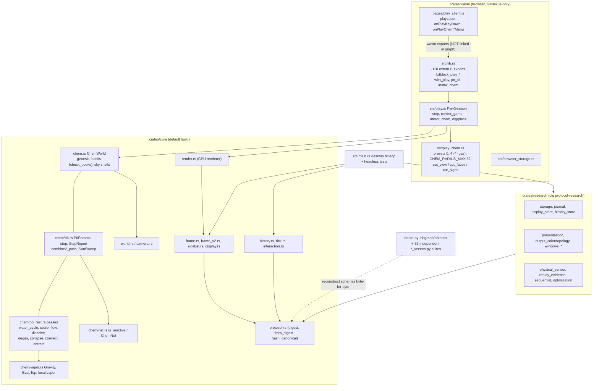

# Bitblock agent onboarding: the knowledge graph

Start here after `docs/HANDOFF.md`. This page is the map for an agent arriving cold: which index answers
which question, what the major subsystems are, where the chem / wasm / play entry points are, which symbols
are hubs, and the hard rules that apply to every change.

Generated 2026-10-29 (PDT) from GitNexus index of commit `3c37db8` on branch `chem/emergent-scale-2026-10`
(remote `Blobicue/bitblock`) plus the committed `index/` (bbgraph). **The source tree is the only truth.**
Both indexes are derived; counts below go stale as the tree moves. Regenerate, then re-check.

## 1. Cold-start order

1. **`docs/HANDOFF.md`**: what is implemented, which claims are safe, recommended work order.
   (Its "Current repository state" section is long audit history; the current line of work is
   `chem/emergent-scale-2026-10` on `Blobicue/bitblock`; see the pointer at its top.)
2. **This page**: layer map, subsystem map, entry points, hubs, rules.
3. **`AGENTS.md`**: how to query `index/` with `python tools/bbgraph.py`, the three gates, known limits.
4. **GitNexus MCP** (`user-gitnexus`, repo `bitblock`): `list_repos` → `query` → `context` → `impact`.
   Skills: `.claude/skills/gitnexus-*/SKILL.md` (and `~/.cursor/skills/gitnexus-*` on the box).
5. **Chem work**: `docs/BITBLOCK_SCALE_EMERGENT.md`, latest sections §5w (coreward gravity), §5x (σ_h
   driver study), §5y (bigger scale + gas planet), then §6 non-goals, §7 risks, §8 next step, §9 files.

## 2. Layer map: which index answers what

| Question | Use | Why |
|---|---|---|
| Which protocol object / schema does module X own, and is it independently vectored? | `bbgraph.py node X`, `schema` | bbgraph parses schema strings and pairs them with `tools/*_vectors.py`. GitNexus does not know what a protocol object is. |
| Which cfg gate is module X behind (default / protocol-research / windows / binary)? | `bbgraph.py node X` | Only 14 of 34 modules are cfg(default) (15 protocol-research, 4 windows, 1 binary). GitNexus indexes every file regardless of cfg. |
| Metric family / definition tag? | `bbgraph.py metric <words>` | 1,112 families from `docs/metrics/registry.tsv`. Not in GitNexus. |
| Module-level dependency strata, load-bearing modules? | `bbgraph.py dag` | 34 modules, 116 textual `crate::` edges, 10 strata. |
| Did I break index accounting / is `index/` stale? | `bbgraph.py gates`, `selftest` | Gates exit non-zero. |
| Who calls function F? What does F call? | GitNexus `context` | Symbol-level CALLS / ACCESSES / HAS_METHOD edges. bbgraph stops at module granularity. |
| What breaks if I change F (blast radius, d=1/2/3, risk)? | GitNexus `impact` | Required before editing a function (see AGENTS.md GitNexus block). |
| "How does X work?" across files, execution flows | GitNexus `query`, `gitnexus://repo/bitblock/process/{name}` | 880 traced flows, hybrid BM25 + embeddings. |
| Anything in `crates/core/src/chem/*.rs`, `crates/wasm/**`, `crates/wasm/pages/*.js`, `examples/*.rs`, Python tool internals | **GitNexus only** | bbgraph's module nodes cover `chem.rs` but not its submodules `chem/{p6,p6_rest,net,vapor,tests_p6}.rs`, and not the wasm crate or the play client. `bbgraph.py node play_chem` → "no node matched". |
| What do my uncommitted changes affect? | GitNexus `detect_changes({scope:"all"})` | Maps diff hunks to symbols and flows. |
| Is a claim safe to make? | `docs/HANDOFF.md` §"Claims that are safe to make" | Neither index decides this. |

Rule of thumb: **bbgraph = protocol, metrics, gates, module DAG; GitNexus = code structure (symbols, calls,
communities, flows, blast radius).** For a module-level edit, check both: `bbgraph.py node <mod>` for gate and
protocol ownership, and GitNexus `impact` on the functions you touch.

| | bbgraph `index/` | GitNexus `.gitnexus/` |
|---|---|---|
| Committed? | Yes (~1.6 MB, LF-pinned) | No. Local-only, self-gitignored, ~185 MB |
| Regenerate | `python tools/bbindex.py` | `node .gitnexus/run.cjs analyze` (see §7) |
| Scale (3c37db8) | 1,533 nodes: 34 modules, 81 schemas, 1,112 metrics, 245 docs, 40 tools, 8 proofs, 13 examples | 174 files, 9,850 nodes, 35,258 edges, 353 communities, 880 processes, 9,167 embeddings (384-d) |
| Freshness check | `bbgraph.py gates` | `gitnexus status` / `gitnexus://repo/bitblock/context` |

## 3. Workspace and subsystem map

Workspace (`Cargo.toml`): root binary `bitblock` (`src/main.rs`, `src/lib.rs`) + `crates/core` +
`crates/research` (feature `protocol-research`) + `crates/wasm` (browser build; `www/` served pages).



Sources: GitNexus community membership (`MEMBER_OF`) and step-1 `STEP_IN_PROCESS` entries; `bitblock_core::`
use counts in `crates/wasm/src` (render 13, chem 13, world 6, sidebar 6, history 5, …); bbgraph `dag`.
Edges are a coupling map, not a compiler answer.

### 3a. GitNexus communities (Leiden), mapped to files

Labels like `Cluster_71` are auto-generated. This table names them by their dominant files. Area skills for
the top 20 are in `.claude/skills/gitnexus-area-*`.

| Community (label, id) | Symbols | Dominant files | Read as |
|---|---:|---|---|
| Examples `comm_1` | 141 | core `render.rs`, wasm `play.rs`, `src/main.rs` | render + play session surface |
| Examples `comm_72` | 86 | core `history.rs`, wasm `lib.rs`, research `history_store.rs` | coordinate history and its wasm exports |
| Cluster_71 | 69 | `src/main.rs` | desktop binary loop / headless tests |
| Cluster_0 | 63 | core `camera.rs` | observer camera |
| Cluster_59 | 63 | core `frame_v2.rs`, research `optimization.rs`, `tick.rs` | frame receipts v2 |
| Chem `comm_12` | 49 | `chem/p6_rest.rs`, `chem/p6.rs`, `chem.rs` | **chem tick passes** |
| Chem `comm_38` / `comm_16` | 46 / 19 | `chem/tests_p6.rs` | chem law tests |
| Cluster_55 | 45 | research `display_store.rs`, `presentation_output.rs` | presentation output store |
| Cluster_131 | 41 | research `journal.rs`, `storage.rs` | journal / storage envelopes |
| Cluster_56 / 163 | 37 / 36 | `display_store.rs` / `physical_sensor.rs` | display artifacts / sensor records |
| Cluster_107 | 35 | core `tick.rs` | tick outcome |
| Cluster_74 | 25 | core `protocol.rs`, `sidebar.rs`, `render.rs` | protocol tags |
| Cluster_244 / 243 | 23 / 20 | wasm `play.rs` | play session internals |
| Cluster_237 / 227 / 221 | 22 / 20 / 21 | wasm `lib.rs`, `browser_storage.rs` | wasm export groups / browser storage |
| Pages | 47 | `crates/wasm/pages/play_client.js` | play client UI |
| Tools (several) | 697 total | `check_planning_docs.py`, `*_vectors.py`, `bbindex.py` | Python tooling and vectors |

Symbols per area (MEMBER_OF): core 1,129, research 883, tools 697, wasm 350, `src/` 156, pages 47.

### 3b. bbgraph subsystems and strata (protocol view)

`python tools/bbgraph.py sub` lists 40 schema-namespace subsystems (frame-receipt, presentation-output-artifact,
windows-present-policy, tick-outcome, world, history, …). `dag` gives 10 strata: stratum 0 = `camera`,
`protocol`, `world`; stratum 1 includes `chem`, `frame`, `program`, `storage`; `protocol` is reached by 30 other
modules. Use this view for protocol / schema / gate questions. Use the GitNexus view above for call paths.

## 4. Entry points: chem / wasm / play

Process entry points (GitNexus step-1 of 880 flows; counts = flows starting there):

- **Browser client** `crates/wasm/pages/play_client.js`: `playLoop`, `onPlayKeyDown` (5),
  `onPlayChemCutMenu` (5), `onPlayChemRebuild` (4), `onPlayChemDynamicsMenu` (3).
- **wasm exports** `crates/wasm/src/lib.rs`: `bitblock_play_load_chem` (→ `install_chem`,
  `PlaySession::with_chem`), `bitblock_play_chem_dynamics` / `_dynamics_get`, `sidebar_composite`; helpers
  `with_play` (23 callers) and `ptr_of` (19).
- **Play session** `crates/wasm/src/play.rs`: `PlaySession::step` (line ~687), `render_pending`, `render_game`,
  `mirror_chem`, `chem_set_dynamics`; bench flows `bench_stage`, `bench_chem_stage`; tests
  `dig_and_place_go_through_chem`, `cross_section_*`.
- **Play chem** `crates/wasm/src/play_chem.rs`: presets (gas = 4), `CHEM_ENERGY_SUN8`, `CHEM_RADIUS_MAX`
  (32); cross-section `cut_view` (11 flows), `cut_faces` (9), `cut_signs` (6).
- **Chem core** `crates/core/src/chem/p6.rs`: `step`, `step_profiled`, `step_profiled_fine`, `combine2_pass`;
  `chem/p6_rest.rs` (57 flows): `water_cycle_pass`, `driven_water_pass`, `driven_dissolve_pass`, `settle_pass`,
  `flow_pass`, `dissolve_pass`, `entrain_pass`, `degas_pass`, `collapse_pass`, `convect_pass`;
  `chem.rs`: `add_sky_shell`, `add_radial_sky_shell`, `land_relief`, `ChemWorld::coreward`; `chem/net.rs`:
  `mount`, `is_reactive`; `chem/vapor.rs`: `Gravity`, `EvapTop`.
- **Desktop binary** `src/main.rs` (233 flows, mostly headless tests): `main`, `resumed`, `window_event`,
  `verify_local_replay_evidence`, `sidebar_snapshot`.

**Cross-language gap.** JS → wasm calls go through `instance.exports.bitblock_play_*`. GitNexus does **not**
link them (the analyzer logged 96 cross-language field sites it declined to link). `context` on an export
shows only Rust tests as callers and `epistemic: lower-bound`. Before changing an export signature or ABI,
`rg bitblock_play_<name> crates/wasm/pages` by hand. ABI is 17; abi16 is frozen (see rules).

## 5. Hubs: treat carefully

Highest distinct-caller counts (CALLS, non-test files). Run `impact` with `summaryOnly: true` first.

| Symbol | File | Callers | Note |
|---|---|---:|---|
| `new` | `src/main.rs` | 83 | ambiguous name; always pass `file_path` |
| `digest` / `from_digest` / `hash_canonical` / `kind` | `crates/core/src/protocol.rs` | 50 / 47 / 37 / 27 | content-address root; bbgraph: reached by 30 other modules |
| `ChemWorld::base` / `from_cells` / `check_books` / `set_mat` | `crates/core/src/chem.rs` | 34 / 31 / 30 / 24 | `check_books`: `impact` = **CRITICAL**, 45 impacted (30 direct) |
| `render::new` / `render` / `pixels` / `width` | `crates/core/src/render.rs` | 40 / 23 / 22 / 20 | render path, needs Owen OK (rules) |
| `encode` | `crates/research/src/storage.rs` | 30 | canonical storage envelope |
| `begin_tick` / `apply_edit` / `head` / `receipts` | `crates/core/src/history.rs` | 28 / 25 / 23 / 19 | |
| `PlaySession::new` / `with_play` / `ptr_of` | wasm `play.rs` / `lib.rs` | 28 / 23 / 19 | |
| `position` | `crates/core/src/camera.rs` | 28 | |
| `set_on` / `new_with_origin` / `bounds` | `crates/core/src/world.rs` | 25 / 23 / 21 | |
| `offset` | `crates/core/src/chem/p6.rs` | 24 | |
| `tag` / `from_bits` | `crates/core/src/tick.rs` | 23 / 21 | |

Structural check: `check` finds **one** import cycle, `frame.rs ↔ render.rs` (crates/core). It is known and
small. Do not add a second.

Analyzer caveat: process discovery was budget-truncated (2,164 of 2,364 candidate entry points never ranked,
41 flows dropped). **A missing flow does not mean the path does not exist.** Confirm with `context` or `rg`.

## 6. Safe first queries

bbgraph (stdlib Python, no network, <1 s; the box has `python3` only, so substitute it for `python`):

```bash
python tools/bbgraph.py stats                 # node counts + gate status
python tools/bbgraph.py selftest              # 50 checks
python tools/bbgraph.py node chem             # gate, deps, schemas, reach for a module
python tools/bbgraph.py ask "canonical framebuffer bytes"   # → frame (term-overlap guess; verify)
python tools/bbgraph.py schema                # 58 protocol objects, all vectored
python tools/bbgraph.py gates                 # staleness / accounting gates
```

GitNexus MCP (`user-gitnexus`, always pass `repo: "bitblock"`):

```text
list_repos {}                                           → bitblock, 174 files, 9,850 nodes, 880 flows
READ gitnexus://repo/bitblock/context                   → freshness
query  {search_query: "chem coreward gravity settle flow toward the core"}
       → flows Settle_pass → Coreward, Flow_pass → Coreward, Driven_dissolve_pass → Coreward;
         defs Gravity (chem/vapor.rs), P6Params.gravity (chem/p6.rs), PlaySession.chem_set_dynamics
context {name: "bitblock_play_load_chem"}               → calls install_chem, PlaySession::with_chem
impact  {target: "check_books", direction: "upstream", summaryOnly: true}  → CRITICAL, 45 impacted
impact  {target: "step", file_path: "crates/wasm/src/play.rs", direction: "upstream"}
       # bare "step" is ambiguous (3 candidates): always disambiguate
detect_changes {scope: "all"}                           → before any commit
check {}                                                → import cycles (expect 1: frame↔render)
```

CLI equivalents (box): `export PATH="/home/box/.local/node-v22/bin:$PATH"`, then
`node .gitnexus/run.cjs query "…" --repo bitblock`, `… impact <sym> --direction upstream --repo bitblock`,
`… cypher "<stmt>" -r bitblock`, `… status`.

Useful Cypher (community labels are `heuristicLabel`; all edges live in `CodeRelation` with `type`):

```cypher
MATCH (s)-[r:CodeRelation {type:'STEP_IN_PROCESS'}]->(p:Process) WHERE r.step = 1 AND s.filePath CONTAINS 'chem'
RETURN s.name, s.filePath, p.heuristicLabel
```

## 7. Hard rules (every agent, every change)

1. **Soft DDA / `bcc-voxel-demo` / abi16: do not touch.** `bcc-voxel-demo` lives outside this repo
   (`/workspace/bcc-voxel-demo`). Inside Bitblock the CPU render path (`crates/core/src/render.rs`, play
   `render_pending` / `render_game`) was left untouched in §5y. Changing it needs Owen's explicit OK.
2. **Chem play is served at http://127.0.0.1:8765** (`python3 -m http.server 8765 -d crates/wasm/www`);
   play page `http://127.0.0.1:8765/play.html`. Build per §5y "Build" (wasm32, `+simd128`, copy wasm into
   `www/`, `python3 crates/wasm/build_pages.py`).
3. **Self-playtest before anything goes to Desktop.** Load the page in Chrome, confirm `books=ok
   energy_drift=0`, lane drift 0, `error=none`, no console errors, and record fps / step_ms, as §5y item 6 does.
4. **Books are law.** Any chem change keeps lane drift 0 and energy drift 0 (`check_books`). Exact-parity
   changes (like the §5y network skip) need a hash parity run, not just tests.
5. **No fake worldgen.** No noise / heightmap / biome authority (BITBLOCK_SCALE_EMERGENT §6).
6. **Uncommitted work stays local-first.** Do not commit or push unless asked. `.gitnexus/` is local only
   (self-gitignored). `index/` is committed and regenerated by `bbindex.py`, never hand-edited.
7. **Before editing a function:** GitNexus `impact` upstream. Warn on HIGH / CRITICAL. Treat UNKNOWN as
   unresolved. **Before committing:** `detect_changes` and `bbgraph.py gates`.

## 8. Keeping both layers fresh

| After | Run |
|---|---|
| any source change you will rely on in queries | `node .gitnexus/run.cjs analyze --skills` (incremental, ~45 s; without `--skills` the area-skill table drops out of the AGENTS.md block). Full rebuild as on 2026-10-29: `GITNEXUS_LBUG_EXTENSION_INSTALL=auto node <gitnexus>/dist/cli/index.js analyze /workspace/bitblock --embeddings --skills -v` with Node 22 (`/home/box/.local/node-v22/bin`); ~215 s. Drop `--embeddings` to skip vectors. |
| module / schema / tool / doc / metric change | `python tools/bbindex.py` then `python tools/bbgraph.py gates` |
| index looks stale in MCP | `gitnexus status`; if `list_repos` lacks bitblock, `gitnexus index /workspace/bitblock` |

`analyze` also rewrites the `<!-- gitnexus:start -->…<!-- gitnexus:end -->` block in `AGENTS.md` / `CLAUDE.md`
and the `.claude/skills/gitnexus-area-*` files. Those regenerate. Keep hand edits outside the markers.

`gitnexus wiki` was not generated: it needs an LLM provider (Cursor CLI, Grok CLI, or an API key). None is on
the box (tried `--provider cursor` and `--provider grok` on 2026-10-29). This page replaces it.
