# Bitblock Knowledge Graph & GraphRAG / DAG Upgrade Plan (`v7 — Loop-5 Handoff-Verified & Subagent-Ready`)

> **Status**: `v7` Architecture & Subagent Execution Contract — Audited Across 5 Loops Including Two Full Passes by 6 Independent Per-Module External Auditors (`EA1..EA6`; `41/41` Total Findings Closed; `0` Open Critical/High/Medium/Low Issues; `90/90` Dry-Run Selftest Checks Pass)  
> **Target Files**: [`tools/bbindex.py`](file:///home/juzz/bitblock/tools/bbindex.py), [`tools/bbgraph.py`](file:///home/juzz/bitblock/tools/bbgraph.py), [`tools/bbselftest.json`](file:///home/juzz/bitblock/tools/bbselftest.json), [`AGENTS.md`](file:///home/juzz/bitblock/AGENTS.md), [`index/*`](file:///home/juzz/bitblock/index/coverage.json)  
> **Baseline Commit**: `3816d35` (`37` modules, `74` protocol schemas, `1,112` metrics, `1,562` nodes, `1,685` edges, `70` selftest checks)

---

## 1. Multi-Loop Empirical Audit Trail (`v1 -> v7`)

### 1.1 Loop-1 Subagent Audit Findings (`v1 -> v2`)
- **[`DAG & Wave Topology Reviewer`](conversation://a587b211-167e-4206-8d57-5a51a3fe574b)**:
  - Proved that naive identifier intersection (`set(dep["pub_items"]) & prod_idents`) produces **`62.8%` false positives** (`773` bogus symbol links across `130` edges) because `40` method/function names (`new`, `encode`, `decode`, `prove`, `tag`, `verify`, plus `"fn"` captured from `pub const fn` by `RE_PUB_ITEM`) are shared across modules.
  - Proved that explicit Rust `use` + qualified-path extraction resolves **`100%` of module edges** (`130/130` prod edges, `34/34` test edges) with **`0` false positives** and without modifying `RE_PUB_ITEM` (preserving `reuse.unreferenced_pub_items = 3`).
  - Identified `45` `(module, dep)` pairs that import a dependency `d` in production scope AND import *additional* symbols from `d` in `#[cfg(test)]` scope (`test_symbol_deps = test_syms - prod_syms`).
  - Verified `production.count(".to_be_bytes()")` matches [`tools/bbmutate.py`](file:///home/juzz/bitblock/tools/bbmutate.py) 100% (`29/37` modules have `> 0` sites, `245` total sites; `render` has `7` and `optimization` has `3`, while `world` and `camera` have `0`).
- **[`Protocol & Tag Triangulation Reviewer`](conversation://e620e7a3-59eb-40d1-b7c9-58d4ba7557ef)**:
  - Counted `145` unique `#bb.<kind>.sha256.<digest>` literal tags in Rust (`33` in `sidebar.rs` production scope are `metric-definition` bindings; `112` in `#[cfg(test)]` scope are protocol test assertions) and `115` unique tags in `tools/*_vectors.py` — including **`8` tags split across lines by Black/Ruff implicit string concatenation** in [`tools/output_topology_vectors.py`](file:///home/juzz/bitblock/tools/output_topology_vectors.py) and [`tools/presentation_output_vectors.py`](file:///home/juzz/bitblock/tools/presentation_output_vectors.py).
- **[`GraphRAG & Governance Reviewer`](conversation://bb16e0a5-2c80-4340-b2d0-6ee005b88cbf)**:
  - Verified that [`tools/check_planning_docs.py`](file:///home/juzz/bitblock/tools/check_planning_docs.py) (`8,470` lines) already owns the parse of `docs/CAPABILITY_TREE.md`, and `ask "SCALE-1"`, `ask "LOCAL-BOUNDS-1"`, `ask "COMMIT-R1"`, and `ask "VERKLE-R1"` already return the exact #1 module, schema, and vector suite. Recommended replacing `capability` nodes with 1-line hyphen/underscore exact-name normalization.

### 1.2 Findings from `/home/juzz/rust-index` (`rustgraph.py`, `src/bin/index.rs`, `repograph/`) & Running `repograph` on Bitblock (`v2 -> v3`)
**[Subagent `Rust-Index & Repograph Deep Researcher`](conversation://f81ff968-3e9d-4596-8d08-fe5b0869deb1)** inspected `/home/juzz/rust-index` and ran `repograph` directly against `/home/juzz/bitblock`:
1. **Where a Code Index Beats `ripgrep`**: Across 30 blind questions (`flate2`, `serde_json`, `tracing-subscriber`), `repograph` search (`28/30`) was statistically indistinguishable from bare `ripgrep` (`29/30`, $z = 0.58$). **The ONE capability in `repograph` that genuinely beats `ripgrep` is the Signature Type Index (`type <Name>`, `returns <Type>`, `takes <Type>`)**, because `rg "-> ContentTag"` misses `Result<ContentTag, Error>`, `Option<ContentTag>`, `rustfmt`-wrapped multiline signatures, and `-> Self` constructors inside `impl` blocks.
2. **Why `bbgraph.py`'s Schema-Subsystem + DAG Ranking (`15/15` on `bbselftest.json`) Beats `repograph`'s Symbol-Only BM25 (`12/15`)**: `bbgraph.py` anchors on **schema-derived subsystems first** and uses **transitive module dependents within the matched subsystem** to order foundational hubs (`world`, `journal`, `history`) above downstream leaf consumers (`octree_commit`, `display_store`, `sequential`).
3. **Seven Concrete Edge Cases Discovered When Running `repograph` on `/home/juzz/bitblock`**:
   - Test-Scope Leakage (`318` test helpers inside `#[cfg(test)] mod tests` indexed as `test=False, role="lib"`).
   - Multiline Attributes (`#[should_panic(\n...\n)]` in `src/main.rs:4757` severing `#[test]`).
   - Multiline Signature Truncation (`329` `rustfmt`-wrapped functions losing 100% of params & returns).
   - `Self` Return/Receiver Blindness (`277` `-> Self` constructors skipped by `TYPE_SKIP`).
   - `df_max=3` Dropping 79 Overloaded Method Names (`807` symbols = `23.8%` with `0` callers).
   - `const _: () = assert!(...)` Indexed as 13 Symbols Named `_`.
   - Workspace & Platform `cfg` Gate Blindness (`0` feature-gated symbols detected).

### 1.3 Loop-2 & Loop-3 Adversarial Audits (`v3 -> v5`)
- **[`Loop-2 Symbol & Signature Auditor`](conversation://0ee25f95-6cd6-4eb0-ace1-0c10209fc44e)** (`L2A-01..05`): Verified `362/362` `impl` headers, `19/19` trait methods (`JournalIo`, `TimingApi`, `DisplayTopologyApi`), `448/448` `#[test]` functions, `0` brace/paren drift in `strip_noise_lines`, and `(?!\s*::)` lookahead on `RE_TYPE_TOKEN`.
- **[`Loop-2 Callers & Impact Auditor`](conversation://6480c21c-d467-407c-8339-b85217e75002)** (`L2B-01..05`): Designed the Call-Syntax-Aware 3-Rule Caller Graph (`RE_QUAL_CALL` + `RE_DOT_CALL` + `RE_BARE_CALL`), cutting caller JSON size by `54.3%` (`255 KB -> 114 KB`) while recovering 100% of `.method()` dot calls, `Self::` calls (`87`), and `self.method()` calls (`325`); caught `\\\n` string continuations (`39` occurrences) and `[T; N]` array-type semicolons (`16` function bodies, `43` return signatures).
- **[`Loop-2 Retrieval & Tag Auditor`](conversation://6498cd96-0a00-4d5b-a745-98536ab889c7)** (`L2C-01..05`) & **[`Loop-3 End-to-End Dry-Run Auditor`](conversation://541e2530-e8bf-4c9e-b2bc-c131fd057f88)** (`L3-01..02`): Verified real multiline-split tags in `output_topology_vectors.py` and `presentation_output_vectors.py`, `doc` `pinned_tags` (`23` sections, `145` tags), `sig_buf` flush before `{` (`0` violations across `1,723` functions), and `80x` faster `cmd_eval` (`8.0s -> 0.10s`).

### 1.4 Loop-4 & Loop-5 Per-Module External Audits (`EA1..EA6`, `v5 -> v7`)
Six independent External Auditors—each assigned to one modular pillar of the plan—audited `v5` (`Loop 4`, `28` findings) and then re-audited `v6` and all cross-subagent handoffs (`Loop 5`, `13` refinements, `0` remaining flaws):

| External Auditor | Assigned Module | Loop-4 Findings (`EA*-01..`) & Loop-5 Handoff Refinements (`EA*-R2-01..`) Closed in `v7` |
|---|---|---|
| **[`External Auditor 1`](conversation://db24f97e-a037-4223-9391-8a5ecb3536c9)** | **Module 1 (Pillar 1)**: Symbols, Scope Stack & Signature Types | • **Loop 4 (`EA1-01..07`)**: `pending_scope` for multiline `impl`/`trait`/`mod` headers before `{`; `brace_depth = entry_depth` initialization for `entry_depth == 1` braceless trait methods; 4-step paren-balanced `signature_types` slicing + `; N` array-length constant stripping (`CHUNK_WORDS`, `KEY_BITS`); strict `pub(?!\s*\()` visibility (`1,306` `pub` vs `9` `pub(crate)`); `impl != TypeName` consumer rule in `cmd_type`.<br>• **Loop 5 (`EA1-R2-01..02`)**: Locked exact first-sentence formula for `s["doc"]` (`body.split(". ")[0].strip()[:140]`) and `extract_symbols_and_tests(lines, clean_lines, edge)` signature so `Subagent M2` reuses `clean_lines` in Pass 2 without modifying `M1`'s function. |
| **[`External Auditor 2`](conversation://ac7ec1b2-2ff4-4455-86d4-922819c43279)** | **Module 2 (Pillar 2)**: `symbol_deps`, `test_symbol_deps` & 2-Pass Caller Graph | • **Loop 4 (`EA2-01..04`)**: Multi-line `#[cfg(test)] use ...;` routing through `";"` (recovering all 5 `LANE_*` constants in `src/main.rs:66-69`); `as` alias stripping and validation against `dep_mod["symbols"]` (recovering `world::is_bedrock`, `camera::ONE_PIXEL_EPSILON`, `frame::VECTOR_CAMERA_LANES`, `display::windows::capture_client`); Two-Pass `extract_modules()`; `(?!\s*::[A-Za-z_])` lookahead and `impl_methods` validation in `RE_QUAL_CALL`; declaration-line `fn <name>` stripping before Rule C; `<mod>::<fn>` normalization and crate-aware `cargo test` hints in `cmd_callers`; `fmt_syms(limit=6)`.<br>• **Loop 5 (`EA2-R2-01`)**: Standardized Rule A module-qualified function calls to record bare `name` (matching Rule C) and typed `method_owners` as `dict[str, set[tuple[str, str]]]`. |
| **[`External Auditor 3`](conversation://46f4acde-88f6-4706-aa0d-2169c44d7d9d)** | **Module 3 (Pillar 3)**: `mutation_sites` & 4-Tier `impact` | • **Loop 4 (`EA3-01..05`)**: Inline `+#[cfg(test)]: <syms>` on `direct_prod` rows in Tier 2 and annotate `(also 2+ hop prod dependent)` on `direct_test_only`; show `intra-target` edges and independent `mut_targets` + `mut_1hop` commands on multi-module `impact`; filter `tool:metric_registry` out of bare vector suite lists and separate `prod_schemas` from `test_scope` schemas in Tier 1; normalize `proofs` paths/stems; symbol-to-module resolution and feature-gated `cargo test` recipes.<br>• **Loop 5 (`EA3-R2-01..03`)**: Defined shared `compute_impact(nodes, edges, dag, targets) -> dict` helper for `M3 -> M6` handoff, locked `hop1_vecs = sorted({v for d in direct_prod for v in mod_vectors(d)} - set(direct_vecs))`, and normalized `module:<name>`, `<path>.rs`, and `<mod>::<sym>` tokens in `cmd_impact`. |
| **[`External Auditor 4`](conversation://baae6f8d-ca90-4463-8ea4-845c3b535084)** | **Module 4 (Pillar 4)**: ContentTag Triangulation & Tool/Doc Digest Hygiene | • **Loop 4 (`EA4-01..04`)**: Fixed greedy `re.match(r'^#!.*\n"""(.*?)"""', text, re.S)` bug in `extract_tools()` (`tools/bbindex.py:315`) -> `r'^#![^\n]*\n"""(.*?)"""'` (restoring summaries on **20 of 42 `tool` nodes** and removing **46 leaked base32 digests** from `tool["terms"]`); enforced `<kind>` equality in `resolve_tag` and intercepted unmatched tags so `cmd_ask` reports `CONFIDENCE LOW` instead of falling through to `rank()`; added `doc` node and `PINNED TAGS` peer display in `cmd_node`.<br>• **Loop 5 (`EA4-R2-01..03`)**: Locked `resolve_tag(nodes, query) -> dict | None` return schema (`{"query", "kind", "digest", "tags", "nodes", "ids"}`) across `M4` and `M6`, added quote/case stripping, and added explicit `M4 -> M5` handoff guard on `cmd_ask()`. |
| **[`External Auditor 5`](conversation://013823b0-265e-4cca-98ac-db84e4c816ea)** | **Module 5 (Pillar 5)**: Retrieval (`ask`), `coverage` & Fast Holdout `eval` | • **Loop 4 (`EA5-01..05`)**: Unified `bbgraph.STOP |= bbindex.STOP` (`23` missing >2-char stopwords); added `sym_hit` (`+8.0`, `named = True`) in `rank()` against `node.get("symbols", ())`; handled `pub_symbol_count == 0` (`lib`, `main`) as `0 / 0 (n/a)` in `cmd_coverage` and `cmd_node`.<br>• **Loop 5 (`EA5-R2-01..03`)**: Preserved `rank()`'s exact 6-tuple return `(scored, qt, coverage, bool(anchored), named, want_kinds)` (`bbgraph.py:251`) and computed `missing` directly in `cmd_ask()`; embedded the verbatim `sym_hit` Python snippet; removed the misleading `s["doc"]` term-stripping parenthetical in `Pillar 5.5` and recorded exact post-upgrade `cmd_eval` scores (`456` `symbol-doc` queries: `49.1%` / `79.2%` strict, `68.4%` / `90.4%` 1-hop). |
| **[`External Auditor 6`](conversation://51667876-1654-413d-8176-06e605478c8d)** | **Module 6 (Pillar 6)**: Subagent Wave Topology, File Locks & 90-Check Selftest Gate | • **Loop 4 (`EA6-01..04`)**: Designed the 6-Subagent (`M1..M6`) modular assignment, exact `+20` (`70 -> 90`) selftest JSON schema, and Invariant 5 freezing `DOC_FILES` (`16` files, `250` sections) and `docs/HANDOFF.md`.<br>• **Loop 5 (`EA6-R2-01..04`)**: Sequenced `Subagent M1..M6` into 6 clean waves (`Wave 1: M1 -> ... -> Wave 6: M6`) so `tools/bbselftest.json` stays at `70/70` through Waves 1–5 (`python3 tools/bbgraph.py selftest` passes `100%` at every intermediate gate `G1..G5` before expanding to `90/90` in Wave 6), and locked the exact `main(argv)` CLI dispatch table. |

---

## 2. Six-Module Architecture Specification (`v7`)

### Invariants & Non-Negotiable Constraints
1. **Six Index Files Only**: Preserve the exact 6 files in `index/` documented in [`AGENTS.md`](file:///home/juzz/bitblock/AGENTS.md): `index/nodes.jsonl`, `index/edges.jsonl`, `index/dag.json`, `index/subsystems.json`, `index/reuse.json`, and `index/coverage.json`.
2. **No New `.py` Files in `tools/`**: [`tools/bbverify.py:82-96`](file:///home/juzz/bitblock/tools/bbverify.py#L82-L96) executes every `.py` file in `tools/` not listed in `SKIP_BARE` as a bare vector validator, and [`tools/bbindex.py:310-312`](file:///home/juzz/bitblock/tools/bbindex.py#L310-L312) indexes every `tools/*.py` (except `bbindex.py` and `bbgraph.py`) as a `tool` node (`44` tools). All new commands (`impact`, `sym`, `type`, `returns`, `takes`, `callers`, `coverage`, `eval`) live inside [`tools/bbgraph.py`](file:///home/juzz/bitblock/tools/bbgraph.py).
3. **`RE_PUB_ITEM` & `dead_surface` Untouched**: Do not modify `RE_PUB_ITEM`, `bbindex.STOP`, or `dead_surface` in [`tools/bbindex.py`](file:///home/juzz/bitblock/tools/bbindex.py) so `pub_items`, module `terms`, and `reuse.unreferenced_pub_items == 3` (`407` prod dup / `341` test dup / `3` unreferenced) remain 100% invariant.
4. **Query-Time Independence**: [`tools/bbgraph.py`](file:///home/juzz/bitblock/tools/bbgraph.py) reads only `index/*` and never re-parses `.rs` source files at query time.
5. **Frozen `DOC_FILES` & Planning Authority (`EA6-04`)**: Do not modify `DOC_FILES` in [`tools/bbindex.py:65-82`](file:///home/juzz/bitblock/tools/bbindex.py#L65-L82) (`16` files, `250` `doc` sections) and do not modify [`docs/HANDOFF.md`](file:///home/juzz/bitblock/docs/HANDOFF.md) or any file governed by [`tools/check_planning_docs.py`](file:///home/juzz/bitblock/tools/check_planning_docs.py). Document new `bbgraph.py` commands exclusively in `tools/bbgraph.py`'s module docstring and [`AGENTS.md`](file:///home/juzz/bitblock/AGENTS.md).

---

### Module 1 (Pillar 1): Span-Aware Symbol, Multiline Signature Type (`type`, `returns`, `takes`), & `Self`-Resolved Method Index
**Assigned Auditor**: [`External Auditor 1`](conversation://db24f97e-a037-4223-9391-8a5ecb3536c9) | **Assigned Implementation Subagent**: **`Subagent M1` (Wave 1)**

#### 1.1 Extraction in [`tools/bbindex.py`](file:///home/juzz/bitblock/tools/bbindex.py) (`strip_noise_lines`, `extract_symbols_and_tests`, `signature_types`)
For each module `(crate, path)` in `module_paths()`, split lines at `edge = min(test_scope_line(text), len(lines))`, compute `clean_lines = strip_noise_lines(lines)`, and call `extract_symbols_and_tests(lines, clean_lines, edge) -> tuple[list[dict], list[dict], int, int]` (`EA1-R2-02`):

1. **Stateful Line-Preserving Comment/String/Char Scanner (`strip_noise_lines`, `L2A-03`, `L2B-02`)**:
   - Process `lines` with persistent `in_str: bool` across lines:
     - Outside a string:
       - Stop at `//` line comment (`break` for the rest of the line).
       - On `"`, enter `in_str = True` and append `" "`.
       - On `'`, if `RE_CHAR_LIT = re.compile(r"^'(?:\\.|[^'\\])'")` matches `line[i:]` (and contains no `\n`), advance past the char literal (`i += len(m.group(0))`) and append spaces, leaving Rust lifetimes (`'a`, `'static`, `'_`) untouched.
     - Inside a string (`in_str == True`):
       - On `\`, advance `i += 2` (if `i + 1 < len(line)` else `i += 1`) and append spaces (`"  "`), preserving `len(clean_lines) == len(lines)` across all `39` trailing `\` multiline string continuations in `interaction.rs`, `program.rs`, and `main.rs` (`L2B-02`).
       - On `"`, exit `in_str = False` and append `" "`.
       - Replace all other string interior characters with `" "`.
   - Verified across all 37 modules: **`0` brace drift and `0` paren drift** at both `edge` and `EOF`.

2. **Enclosing `scope_stack` (`impl`, `trait`, `pub mod`) & `pending_scope` Nesting Guard (`L2A-01`, `L2A-02`, `EA1-01`)**:
   - Match headers on `clean_lines[i]` via:
     ```python
     RE_IMPL_HEAD = re.compile(
         r"^\s*(?:unsafe\s+)?impl(?:\s*<[^>]*>)?\s+(?:.+?\s+for\s+)?"
         r"(?:&\s*(?:'[a-z_][A-Za-z0-9_]*\s+)?(?:mut\s+)?)?([A-Za-z_][A-Za-z0-9_]*)"
     )
     RE_TRAIT_HEAD = re.compile(
         r"^\s*(?:pub(?:\s*\([^)]*\))?\s+)?(?:unsafe\s+)?trait\s+([A-Za-z_][A-Za-z0-9_]*)"
     )
     RE_MOD_HEAD = re.compile(
         r"^\s*(?:pub(?:\s*\([^)]*\))?\s+)?mod\s+([A-Za-z_][A-Za-z0-9_]*)"
     )
     ```
   - Maintain `scope_stack: list[tuple[int, str | None]]` and `pending_scope: tuple[int, str | None] | None = None` across production lines `0..edge` (`EA1-01`):
     - On line `i`, record `entry_depth = depth` and `expected_depth = scope_stack[-1][0] if scope_stack else 0`.
     - **Check `RE_DECL` at `entry_depth == expected_depth` FIRST** (before pushing any new frame for line `i`), with `impl_type = scope_stack[-1][1] if scope_stack else None`.
     - Next, if `entry_depth == expected_depth`:
       - If `RE_IMPL_HEAD` or `RE_TRAIT_HEAD` matches `clean_lines[i]`, set `pending_scope = (entry_depth + 1, m.group(1))`.
       - Else if `RE_MOD_HEAD` matches `clean_lines[i]` and `";" not in clean_lines[i]`, set `pending_scope = (entry_depth + 1, None)`.
     - If `pending_scope is not None` and `"{" in clean_lines[i]`: `scope_stack.append(pending_scope); pending_scope = None` (else if `pending_scope is not None` and `";" in clean_lines[i]`: `pending_scope = None`).
     - Update `depth += clean_lines[i].count("{") - clean_lines[i].count("}")` and pop `while scope_stack and depth < scope_stack[-1][0]: scope_stack.pop()`.
   - Captures `362/362` `impl` blocks, `19/19` trait methods (`JournalIo`, `TimingApi`, `DisplayTopologyApi`), and `display::windows::capture_client`, while rejecting all `5/5` function/macro-local inner items.

3. **Multiline Attribute Scanner & Bracket-Balanced `end` Line Scanner (`L2A-02`, `L2B-02`, `EA1-02`, `EA1-05`, `EA1-R2-01`)**:
   - Match declarations via:
     ```python
     MODS = r"(?:pub(?:\s*\([^)]*\))?\s+)?(?:async\s+)?(?:const\s+)?(?:unsafe\s+)?"
     RE_DECL = re.compile(
         r"^\s*" + MODS
         + r"(fn|struct|enum|trait|type|const|static|macro_rules!)\s+"
         + r"(?:<[^>]*>\s*)?(_?[A-Za-z0-9][A-Za-z0-9_]*)"
     )
     RE_STRICT_PUB = re.compile(r"^\s*pub(?!\s*\()\b")
     ```
     (Rejecting `name == "_"` so `13` `const _: () = assert!(...)` items are ignored).
   - Set `is_pub = bool(RE_STRICT_PUB.match(clean_lines[i]))` so the `9` `pub(crate)` items have `"pub": False` (`EA1-05`, yielding exact `1,306` `pub: True` symbols and `462` documented `pub: True` symbols).
   - Walk backward from `i - 1` tracking square-bracket balance `bracket_depth` (`]` increments, `[` decrements) to extract `///` doc comments and `#[test]` attributes across multiline attributes (`#[should_panic(\n...\n)]` in `src/main.rs:4757`). Format `doc_lines` via the exact first-sentence formula (`EA1-R2-01`):
     ```python
     body = " ".join(x for x in reversed(doc_lines) if x).strip()
     first = body.split(". ")[0].strip()
     if first and not first.endswith("."):
         first += "."
     doc = first[:140]
     ```
   - In test scope (`lines[edge:]`), do **not** apply a `depth` filter when extracting `#[test] fn` items so both depth-1 (`mod tests`, `432`) and depth-2 (`mod file_backed` in `history_store.rs` and `journal.rs`, `16`) test functions are captured (`448 / 448`).
   - Compute `end` line of each declaration by scanning forward `for k in range(i, stop_line):` initialized with **`brace_depth = entry_depth`**, `paren_depth = 0`, `bracket_depth = 0`, `seen_open = False` (`EA1-02`):
     - If `{` is seen at `paren_depth == 0 and bracket_depth == 0`, set `seen_open = True` and stop on the line where `brace_depth` returns to `<= entry_depth`.
     - Before `seen_open`, stop on `;` **only when `brace_depth == entry_depth and paren_depth == 0 and bracket_depth == 0`** (handling both `entry_depth == 1` braceless trait methods and `[T; N]` array parameters, `L2B-02`, `EA1-02`).

4. **Multiline Function Signature Joiner & 4-Step `signature_types(sig, impl_type)` (`L2A-04`, `L2A-05`, `L2B-02`, `L3-02`, `EA1-03`, `EA1-04`)**:
   - For `kind == "fn"`: join `clean_lines[i..k]` until `{` (at `paren_depth == 0 and bracket_depth == 0`, appending characters before `{` to `sig_buf` before setting `sig_done = True` per `L3-02`) or `;` (at `paren_depth == 0 and bracket_depth == 0`).
   - For `kind != "fn"`: normalize `" ".join(clean_lines[i].split("{", 1)[0].split("=", 1)[0].rstrip(";").strip().split())`.
   - Parse `(takes, returns)` for `kind == "fn"` using the exact 4-step paren-balanced slicer (`EA1-03`, `EA1-04`):
     ```python
     RE_TYPE_TOKEN = re.compile(r"\b([A-Z][A-Za-z0-9_]*)\b(?!\s*::)")
     RE_ARRAY_LEN = re.compile(r";\s*[^;\]]+(?=\])")
     TYPE_SKIP = {
         "Result", "Option", "Vec", "Box", "String", "Formatter", "Fn", "FnMut",
         "FnOnce", "AsRef", "IntoIterator", "IntoIter", "Iterator", "Item", "Output",
         "Err", "Default", "Clone", "Copy", "PartialEq", "Eq", "PartialOrd", "Ord",
         "Hash", "Debug", "Display", "Error", "Read", "Write", "Seek", "SeekFrom",
         "Send", "Sync", "Sized", "From", "Into", "TryFrom", "TryInto", "FromStr",
         "FromIterator", "Drop", "Deref", "DerefMut", "Add", "AddAssign", "Sub",
         "SubAssign", "Mul", "MulAssign", "Div", "Neg", "Ordering",
     }
     ```
     1. Find `open_paren = sig.find("(")` and walk forward with `paren_depth` to find the matching `close_paren`.
     2. Slice `head = sig[:open_paren]`, `params_part = sig[open_paren : close_paren + 1]`, and `tail = sig[close_paren + 1 :]`.
     3. Split `tail` at `\bwhere\b` first (`ret_zone, where_part`), then extract `ret_part` after `->` in `ret_zone` (so `->` inside closure parameters or `where` bounds never leaks into `returns`).
     4. In `head`, split `<...>` on top-level commas (at `<`/`>` depth `0`): tokens before `:` go into `declared` (skipped) and tokens after `:` go into `head_bounds` (scanned alongside `params_part` and `where_part` for `takes`). Strip fixed-size array length constants `; <expr>` before `]` via `RE_ARRAY_LEN.sub("", s)` (`EA1-04` so `CHUNK_WORDS`, `FRAME_RECEIPT_V2_PAYLOAD_LEN`, and `KEY_BITS` are not indexed as types).
     5. Skip `t in TYPE_SKIP or t in declared or len(t) == 1`. Substitute `t == "Self"` with `impl_type` when `impl_type` is present, and prepend `impl_type` to `takes` when `\bself\b` appears in `params_part`.

5. **Per-Module Symbol Storage in `index/nodes.jsonl` (`L2A-02`, `L2B-03`, `EA1-05`)**:
   - On each `module` node in `index/nodes.jsonl`, store:
     - `"pub_documented"`: count of `pub: True` production symbols in this module with a `///` doc comment (`462` across the crate).
     - `"pub_symbol_count"`: count of `pub: True` production symbols in this module (`1,306` across the crate).
     - `"symbols"`: list of production symbol dicts (`2,475` across the crate: required keys `{"name", "kind", "line", "end", "pub"}`, optional non-empty keys `"doc"`, `"impl"`, `"sig"`, `"takes"`, `"returns"`, `"calls"`).
     - `"test_fns"`: list of `#[test]` function spans (`448` across the crate: `{"name", "line", "end", "calls"}`, omitting `"calls"` when empty).

#### 1.2 New `bbgraph.py` Commands: `sym`, `type`, `returns`, `takes` (`EA1-06`)
- Exit with `die(...)` (`code 2`) on missing CLI argument or when `0` symbols/types match (trying exact case-sensitive match first, then case-insensitive fallback).
- `python3 tools/bbgraph.py sym <name>`: Accepts `<name>` or `<Type>::<name>`; prints `path:line-end`, `cfg(gate)`, kind, `impl`, `sig`, `doc`, `takes`, `returns`, and `calls`.
- `python3 tools/bbgraph.py type <TypeName>`: Prints:
  1. `DEFINED AT`: Module path, `line-end`, `cfg(gate)`, `kind`, `doc`.
  2. `RETURNED BY (constructors / producers)`: Functions where `TypeName in s.get("returns", ())` (marking `impl == TypeName` constructors first).
  3. `METHODS (impl <TypeName>)`: Functions where `s.get("impl") == TypeName`, sorted with inherent `pub: True` methods before trait-impl methods (`(not s["pub"], s["line"])`).
  4. `TAKEN BY (external consumers)`: Functions where `TypeName in s.get("takes", ())` **and `s.get("impl") != TypeName`** (`EA1-06`).
- `python3 tools/bbgraph.py returns <TypeName>` and `python3 tools/bbgraph.py takes <TypeName>`.

---

### Module 2 (Pillar 2): Explicit `symbol_deps`, `test_symbol_deps`, & Two-Pass Call-Syntax-Aware Caller Graph (`callers`)
**Assigned Auditor**: [`External Auditor 2`](conversation://ac7ec1b2-2ff4-4455-86d4-922819c43279) | **Assigned Implementation Subagent**: **`Subagent M2` (Wave 2)**

#### 2.1 Explicit Cross-Module `symbol_deps` and `test_symbol_deps` (`L2B-04`, `EA2-01`, `EA2-04`)
- Partition module lines into `prod_text` and `test_text` (`EA2-01`):
  - When iterating `lines[:edge]`, if `lines[i].strip() == "#[cfg(test)]"` and the next non-blank line `lines[j].lstrip().startswith("use ")`, route all lines `lines[j..k]` **through the line containing `";"` (inclusive)** to `test_lines` (recovering all 5 `LANE_*` constants in `src/main.rs:66-69`'s 3-line braced `#[cfg(test)] use bitblock::tick::{...};`).
  - Use the exact regexes (`EA2-01`, `EA6-03`):
    ```python
    RE_ROOT_USE = re.compile(
        r"\buse\s+(?:crate|bitblock|bitblock_core|bitblock_research)::\{([^;]+)\};", re.S
    )
    RE_USE_BRACES = re.compile(
        r"\b(?:crate|bitblock|bitblock_core|bitblock_research)::([a-z0-9_]+)::\{([^}]+)\}", re.S
    )
    RE_QUAL_SYM = re.compile(
        r"\b(?:crate|bitblock|bitblock_core|bitblock_research)::([a-z0-9_]+)::(?:windows::)?([A-Za-z_][A-Za-z0-9_]*)"
    )
    ```
  - Strip ` as ` aliases via `item.strip().split(" as ")[0].strip()`, ignore `"self"` and `"windows"`, and validate candidate symbols against `valid_syms = {s["name"] for s in dep_mod["symbols"] if not s.get("impl")} | (set(dep_mod["pub_items"]) - {"fn"})` (`EA2-01`).
- Store `"symbol_deps"` (`130/130` prod edges) and `"test_symbol_deps"` (`test_syms - prod_syms` across `test_deps` and production `deps` with extra test imports) on each `module` node.
- In `bbgraph.py node`, `bbgraph.py wave`, and `bbgraph.py impact`, format symbol lists with `fmt_syms(syms, limit=6)` (`EA2-04`), and in `cmd_node` print `TEST DEPS` whenever `node.get("test_deps") or node.get("test_symbol_deps")`.

#### 2.2 Two-Pass Call-Syntax-Aware 3-Rule Caller Graph (`bbgraph.py callers <target>`, `L2B-01`, `EA2-02`, `EA2-03`, `EA2-R2-01`)
Run `extract_modules()` in **two passes** across all 37 modules (`EA2-02`, `EA6-03`, `EA1-R2-02`):
- **Pass 1 (Per-Module Extraction)**: Retain `(node, lines, clean_lines, edge)` from `extract_symbols_and_tests(lines, clean_lines, edge)` for all 37 modules, and build workspace-wide tables (`EA2-R2-01`):
  - `module_names: set[str]` (`37` modules),
  - `impl_methods: dict[str, set[str]]` (`impl_type -> set of method names`),
  - `method_owners: dict[str, set[tuple[str, str]]]` (`method_name -> set of (mod_name, impl_type)`),
  - `top_fn_owners: dict[str, set[str]]` (`fn_name -> set of owning mod_names` for `kind == "fn"` with `impl is None`).
- **Pass 2 (Cross-Module `symbol_deps`, `test_symbol_deps`, and `calls` Resolution)**:
  - For each production `fn` span (`line..end`) and each `#[test]` function span (`line..end`), copy `span_lines = list(clean_lines[line - 1 : end])` and strip the declaration header `fn <fn_name>` on `span_lines[0]` (`EA2-02` so Rule C never self-matches `encoded_len` on its own signature line).
  - Define `self_target = f"{self_impl}::{fn_name}" if self_impl else fn_name`, and scan `"\n".join(span_lines)` using:
    1. **Rule A — Qualified Calls (`RE_QUAL_CALL = re.compile(r"\b([A-Za-z_][A-Za-z0-9_]*)::(?:windows::)?([a-z_][A-Za-z0-9_]*)\b(?!\s*::[A-Za-z_])")`, `EA2-02`, `EA2-R2-01`)**:
       - Substitute `Qualifier == "Self"` with `self_impl` when inside an `impl` block (`recovering 87 Self:: calls`).
       - If `Qualifier in impl_methods` and `name in impl_methods[Qualifier]`, record `f"{Qualifier}::{name}"` (if `!= self_target`).
       - Else if `Qualifier in module_names` and `Qualifier in top_fn_owners.get(name, ())`, record bare `name` (if `name != self_target`, `EA2-R2-01`).
    2. **Rule B — Receiver Dot-Calls (`RE_DOT_CALL = re.compile(r"(?:\b([A-Za-z_][A-Za-z0-9_]*)|[)\]])\s*\.\s*([a-z_][A-Za-z0-9_]*)\s*(?:::<[^>]*>)?\s*\(")`)**:
       - If `recv == "self"` and `self_impl` and `method in impl_methods.get(self_impl, ())`, record `f"{self_impl}::{method}"` (if `!= self_target`, `recovering 325 self.method() calls`).
       - Otherwise, if `method` is declared on `1..=3` types across the workspace (`1 <= len(method_owners.get(method, ())) <= 3`), filter candidate `(owner_mod, owner_type)` to `owner_mod in allowed_mods` (`{mod_name} | set(deps)` in prod, `{mod_name} | set(deps) | set(test_deps)` in tests), prefer `owner_type`s mentioned in the caller span if multiple remain, and record `f"{owner_type}::{method}"` (if `!= self_target`).
    3. **Rule C — Bare Top-Level Function Calls (`RE_BARE_CALL = re.compile(r"(?<![.\w:])([a-z_][A-Za-z0-9_]*)\s*(?:::<[^>]*>)?\s*\(")`)**:
       - If `fn_name in top_fn_owners` with `1 <= len(top_fn_owners[fn_name]) <= 3` and `top_fn_owners[fn_name] & allowed_mods`, record `fn_name` (if `!= self_target`).
  - Store `sorted(set(calls))` on the `fn` / `test_fn` dict (omitting `"calls"` when empty).
- **`python3 tools/bbgraph.py callers <name | Type::method | mod::fn>` (`EA2-03`, `EA2-R2-01`)**:
  - Normalize 3-segment `<mod>::<Type>::<method>` to `<Type>::<method>`; for 2-segment `<mod>::<fn>` where `<mod> in module_names`, match `c == fn` in caller modules where `<mod> in ({m["name"]} | set(m["deps"]) | set(m.get("test_deps", ())))`; otherwise match `c == target` (when `"::" in target`) or `c == target or c.endswith("::" + target)` (when bare).
  - Print `PRODUCTION CALLERS` and `UNIT TEST CALLERS (#[test])` with a crate- and feature-aware `cargo test` command (`-p bitblock-core`, `-p bitblock-research`, `--bin bitblock --features protocol-research`, or `--workspace --features protocol-research`, `EA2-03`).

---

### Module 3 (Pillar 3): `mutation_sites` Accounting & 4-Tier `bbgraph.py impact <modules...>`
**Assigned Auditor**: [`External Auditor 3`](conversation://46f4acde-88f6-4706-aa0d-2169c44d7d9d) | **Assigned Implementation Subagent**: **`Subagent M3` (Wave 3)**

1. **Record `"mutation_sites": production.count(".to_be_bytes()")`** on each `module` node in `index/nodes.jsonl` (`29/37` modules have `> 0` sites, `245` total sites, matching `tools/bbmutate.py` 100% per `L2B-05`).
2. **Expose `compute_impact(nodes, edges, dag, targets) -> dict` & `python3 tools/bbgraph.py impact <modules...>` (`EA3-01..05`, `EA3-R2-01..03`)**:
   - Normalize each CLI token `tok` (`EA3-R2-03`):
     1. Strip optional `"module:"` prefix; if `tok.endswith(".rs")`, take `Path(tok).stem`. If in `by_name`, add to `targets`.
     2. Else if `"::" in tok` and `tok.split("::", 1)[0] in by_name`, resolve to `tok.split("::", 1)[0]` and print a hint for `bbgraph.py callers <tok>`.
     3. Else check `s["name"] == tok` or `f"{s.get('impl')}::{s['name']}" == tok` (with case-insensitive fallback) across `module["symbols"]`; if matched, resolve to its owning module(s) and print a hint for `bbgraph.py callers <tok>`, else exit with `die(...)` (`code 2`).
   - Implement `compute_impact(nodes, edges, dag, targets) -> dict` returning `{"targets", "direct_prod", "direct_test_only", "trans_2plus", "direct_vecs", "hop1_vecs", "mut_targets", "mut_1hop", "proofs"}` (`EA3-R2-01`, shared by `cmd_impact` and `cmd_selftest`), with:
     ```python
     direct_vecs = sorted({v for t in targets for v in mod_vectors(t)})
     hop1_vecs = sorted({v for d in direct_prod for v in mod_vectors(d)} - set(direct_vecs))
     ```
     where `mod_vectors(m)` resolves `e["kind"] == "vectors"` and `e["from"] != "tool:metric_registry"` across all `mods[m]["declares"]` (`EA3-R2-02`).
   - **Tier 1 — TARGET MODULES**: Path, `cfg(gate)`, stratum, `mutation_sites`, `tests`, production declared schemas (`declares - test_scope`, noting `+N test-scope schema(s)` when present, `EA3-03`), `direct_vecs`, direct Lean 4 `proofs` (relative paths, `EA3-04`), and `intra-target` symbol dependencies when `len(targets) > 1` (`EA3-02`).
   - **Tier 2 — DIRECT 1-HOP DEPENDENTS (`depends_on` & `tests_with`, `EA3-01`)**:
     1. **Production 1-Hop Dependents (`depends_on`)**: List each module in `direct_prod = sorted({m for m in mods if set(m["deps"]) & tset} - tset)` once with its `symbol_deps` (formatted via `fmt_syms`) and inline any extra `#[cfg(test)]` symbol imports (`+#[cfg(test)]: <syms>`) on the same row.
     2. **Test-Only 1-Hop Dependents (`tests_with`, no 1-hop prod edge)**: List `direct_test_only = sorted(m for m in mods if (set(m["test_deps"]) & tset) and m not in (tset | set(direct_prod)))` with `test_symbol_deps`, appending `(also 2+ hop prod dependent)` when `m in trans_2plus`.
   - **Tier 3 — TRANSITIVE DEPENDENTS (`2+` Hops)**: `trans_2plus = all_transitive_prod_dependents(targets) - tset - set(direct_prod)`, grouped compactly by DAG stratum.
   - **Tier 4 — VERIFICATION RECIPE (`EA3-02`, `EA3-03`, `EA3-05`, `EA3-R2-02`)**:
     - Feature-aware `cargo test` command (`--workspace --features protocol-research` when any target or 1-hop dependent is research/feature-gated or `main`, else `--workspace`),
     - `direct_vecs` and `hop1_vecs` (emitting `python3 tools/bbverify.py full` when `> 8` suites),
     - Independent `bbmutate.py` commands for `mut_targets` (targets with `mutation_sites > 0`) and `mut_1hop` (1-hop encoders for `0`-site targets), or `mutation: none` when both are empty (`impact lib`),
     - Lean 4 proof capsules (`(cd proof && lake build)` when `proofs` is non-empty).

---

### Module 4 (Pillar 4): Multiline-Concat-Aware `#bb.<kind>.sha256.<digest>` Triangulation (`pinned_tags`) & Tool/Doc Digest Hygiene
**Assigned Auditor**: [`External Auditor 4`](conversation://baae6f8d-ca90-4463-8ea4-845c3b535084) | **Assigned Implementation Subagent**: **`Subagent M4` (Wave 4)**

1. **Fix Tool Docstring Extraction & Extract `pinned_tags` in [`tools/bbindex.py`](file:///home/juzz/bitblock/tools/bbindex.py) (`L2C-01`, `L2C-04`, `EA4-01`, `EA4-04`)**:
   - In `extract_tools()` (`tools/bbindex.py:315`), replace `re.match(r'^#!.*\n"""(.*?)"""', text, re.S)` with `re.match(r'^#![^\n]*\n"""(.*?)"""', text, re.S)` (`EA4-01`, fixing `20` corrupted tool summaries and removing `46` leaked base32 digests from `tool["terms"]`).
   - Use `RE_CONTENT_TAG = re.compile(r"#bb\.([a-z0-9-]+)\.sha256\.(?:[\"']\s*[\"'])?([a-z2-7]{52})")` and `RE_B32_DIGEST = re.compile(r"^[a-z2-7]{52}$")` to extract `pinned_tags` (omitting the key when empty) on:
     - `module` nodes from `behind_tests` (`112` unique Rust protocol test tags across 28 of 37 modules),
     - `tool` nodes from full Python text (`115` unique vector tags across 26 of 42 tools, including all `8` Black/Ruff multiline-split tags),
     - `doc` nodes from markdown section body (`145` unique tags across `23` doc sections in `docs/PROTOCOL.md` and `docs/DISPLAY_AUDIT.md`, while stripping `RE_B32_DIGEST` from `doc["terms"]`, `L2C-04`).
2. **Intercept Tag Queries via `resolve_tag(nodes, query) -> dict | None` in `cmd_node` and `cmd_ask` (`L2C-02`, `EA4-02`, `EA4-03`, `EA4-R2-01..03`)**:
   - Normalize `q = query.strip().strip("\"'").strip().lower()` and match `RE_TAG_QUERY = re.compile(r"^(?:#bb\.([a-z0-9-]+)\.sha256\.([a-z0-9]*)|([a-z2-7]{52}))$")` at the start of `cmd_node` and `cmd_ask` before calling `find_node()` or `rank()` (`EA4-02`, `EA4-R2-02`).
   - When `RE_TAG_QUERY` does not match, return `None`. When it matches, return the exact dict (`EA4-R2-01`, `EA6-R2-03`):
     ```python
     {
         "query": query.strip(),
         "kind": kind,                  # str | None
         "digest": digest,              # str
         "tags": sorted(matched_tags),  # list[str]
         "nodes": hits,                 # list[dict] sorted by n["id"]
         "ids": [n["id"] for n in hits] # list[str] sorted by n["id"]
     }
     ```
     enforcing full-tag equality `t == f"#bb.{kind}.sha256.{digest}"` when `kind` is provided (`EA4-02` so `#bb.world.sha256.aaaa...` never collides with `#bb.storage-record.sha256.aaaa...` in `src/main.rs:6336`) and `t.endswith("." + digest)` when a bare 52-char digest is queried.
   - If `resolve_tag` returns `not hit["nodes"]`, `cmd_node` exits with `die(...)` (`code 2`) and `cmd_ask` prints `NOTHING IN THE INDEX MATCHED THIS WORDING.` + `CONFIDENCE LOW  nothing matched` and returns `0` (`EA4-02`).
   - Also match `n.get("alias") == name` (and case-insensitive `(n.get("alias") or "").lower() == name.lower()`) in `find_node()`, and in `cmd_node` add:
     1. `elif node["kind"] == "doc":` displaying `cites_src` (`CITES MODULES`) and `metric_refs` (`CITES METRICS`),
     2. A shared `PINNED TAGS (%d)` footer for any node (`module`, `tool`, `doc`) with non-empty `node.get("pinned_tags")`, cross-referencing peer node IDs (`EA4-03`, `EA4-R2-02`).

---

### Module 5 (Pillar 5): Evidence-Calibrated Retrieval (`ask`), Doc Coverage (`coverage`), & Fast Holdout Benchmark (`eval`)
**Assigned Auditor**: [`External Auditor 5`](conversation://013823b0-265e-4cca-98ac-db84e4c816ea) | **Assigned Implementation Subagent**: **`Subagent M5` (Wave 5)**

1. **Unify `bbgraph.STOP` with `bbindex.STOP` (`EA5-01`)**:
   - Add the `23` >2-char stopwords from `bbindex.STOP` (`after`, `also`, `because`, `before`, `both`, `could`, `done`, `had`, `has`, `have`, `here`, `over`, `rather`, `should`, `still`, `their`, `them`, `there`, `they`, `under`, `were`, `will`, `would`) to `bbgraph.STOP` in [`tools/bbgraph.py`](file:///home/juzz/bitblock/tools/bbgraph.py), eliminating false `NOT IN THIS INDEX` warnings and coverage penalties while keeping `70/70` selftest checks 100% invariant.
2. **Preserve `rank()`'s 6-Tuple Signature, Remove 1-Hop Expansion & Report `NOT IN THIS INDEX` in `cmd_ask` (`L2C-05`, `EA5-01`, `EA4-R2-03`, `EA5-R2-01`, `EA6-R2-01`)**:
   - **Keep `Subagent M4`'s `resolve_tag(nodes, query)` interception block at the top of `cmd_ask()` intact (`EA4-R2-03`)**, and **keep `rank(nodes, subs, dag, query)`'s existing 6-tuple return signature `(scored, qt, coverage, bool(anchored), named, want_kinds)` (`tools/bbgraph.py:251`) 100% unchanged (`EA5-R2-01`, `EA6-R2-01`)**.
   - Remove the dead `edges = load_edges()` and 1-hop `NEIGHBOURS` expansion in `cmd_ask` (`bbgraph.py:318-336`).
   - Inside `cmd_ask()`, compute `missing` directly from `nodes` and `qt` (`EA5-R2-01`) and print `NOT IN THIS INDEX` before `if not scored:`:
     ```python
     per_kind, _ = document_frequency(nodes)
     missing = [
         t for t in dict.fromkeys(qt)
         if all(per_kind.get(k, {}).get(t, 0) == 0 for k in per_kind)
     ]
     print('QUERY  "%s"' % query)
     if missing and not named:
         print("NOT IN THIS INDEX: %s" % ", ".join(missing))
     if not scored:
         ...
     ```
3. **Hyphen/Underscore Exact Module Name Match & Verbatim `sym_hit` Symbol Boosting in `rank()` (`EA5-02`, `EA5-R2-02`)**:
   - Inside `rank()`, before `for node in nodes:`, compute:
     ```python
     raw_ident = {
         w.lower() for w in re.findall(r"[A-Za-z0-9_]+", query)
         if "_" in w or any(c.isupper() for c in w[1:])
     }
     quals = re.findall(r"([a-z0-9_]+)::([a-z0-9_]+)", query.lower())
     ```
   - Inside `for node in nodes:`, compute `exact`, `spelled`, and `sym_hit` (`EA5-R2-02`):
     ```python
     exact = bool(name) and (name in rawset or name.replace("_", "-") in rawset)
     parts = [p for p in re.split(r"[_\-/]", name) if len(p) > 2]
     spelled = bool(parts) and len(parts) > 1 and all(p in rawset for p in parts)
     sym_hit = False
     if node["kind"] == "module" and (quals or raw_ident) and node.get("symbols"):
         for s in node["symbols"]:
             sname = s["name"].lower()
             simpl = (s.get("impl") or "").lower()
             if quals and any((q == simpl or q == name) and m == sname for q, m in quals):
                 sym_hit = True
                 matched_terms.update(tokens(s["name"]) + tokens(simpl))
                 break
             if sname in raw_ident and ("_" in sname or s["kind"] in ("struct", "enum", "trait", "type", "const")):
                 sym_hit = True
                 matched_terms.update(tokens(s["name"]))
     score = hit
     if exact:
         score += 10.0
         named = True
         matched_terms.update(t for t in qt if t in tokens(name))
     elif sym_hit:
         score += 8.0
         named = True
     elif spelled:
         score += 7.0
         named = True
         matched_terms.update(t for t in qt if t in tokens(name.replace("_", " ")))
     ```
4. **Per-Module Symbol Documentation Coverage (`bbgraph.py coverage` & `node <mod>`, `EA5-03`)**:
   - Print crate-wide `//!` module doc coverage (`36/37 = 97%`), public symbol `///` coverage (`462/1,306 = 35%`), schema vector coverage (`74/74 = 100%`), and per-module symbol doc breakdown sorting `pub_symbol_count == 0` modules (`lib`, `main`) last as `0 / 0 (n/a)` and flagging modules with `pub_symbol_count > 0` and `< 25%` coverage with `<-- use sym/type/callers here` (`EA5-03`).
5. **Fast Self-Supervised Holdout Retrieval Benchmark (`python3 tools/bbgraph.py eval`, `L2C-03`, `EA5-04`, `EA5-05`, `EA5-R2-03`)**:
   - Pass `mod_nodes = [n for n in nodes if n["kind"] == "module"]` (`37` nodes) to `rank()` (`~0.20s` total runtime, `80x` faster).
   - Evaluate 3 holdout sets derived in-memory from `index/nodes.jsonl` (reporting both strict `ok = {m["name"]}` and 1-hop `ok = {m["name"]} | set(m["deps"]) | set(m.get("test_deps", ()))` Top-1 / Top-3):
     - **`module-doc` (`36` queries)**: Reconstruct the held-out module's `terms` cleanly from `m["doc"][len(m["summary"]):]` + `m["name"]` + `m["pub_items"]` + `m["declares"]` (`38.9%` Top-1 / `75.0%` Top-3 strict; `83.3%` Top-1 / `94.4%` Top-3 1-hop).
     - **`symbol-doc` (`456` queries with `len(qt) >= 3` out of `462` documented `pub` symbols, `EA5-R2-03`)**: Query `s["doc"]` directly against `rank(mod_nodes, subs, dag, s["doc"])` without mutating `m["terms"]` (since `///` symbol docs are already absent from `m["terms"]` by construction; `49.1%` Top-1 / `79.2%` Top-3 strict; `68.4%` Top-1 / `90.4%` Top-3 1-hop).
     - **`test-name` (`448` queries total + `388` library-module subset excluding `main.rs`'s `60` CLI integration tests, `EA5-05`, `EA5-R2-03`)**: `#[test]` function names from `m["test_fns"]` (`35.9%` / `56.0%` strict, `65.4%` / `83.9%` 1-hop across all `448`; `40.2%` / `62.1%` strict, `60.8%` / `81.4%` 1-hop across the `388` library-module subset).

---

## 3. Module 6 (Pillar 6): 90-Check Selftest Manifest (`tools/bbselftest.json`) & `cmd_selftest()` Contract
**Assigned Auditor**: [`External Auditor 6`](conversation://51667876-1654-413d-8176-06e605478c8d) | **Assigned Implementation Subagent**: **`Subagent M6` (Wave 6)**

Extend [`tools/bbselftest.json`](file:///home/juzz/bitblock/tools/bbselftest.json) from **`70` checks to `90` checks (`+20` new checks)** with the exact JSON keys and `cmd_selftest()` validation rules audited in `EA1-07`, `EA2-01`, `EA3-04`, `EA3-R2-01`, `EA4-R2-01`, `EA6-02`, and `EA6-R2-03`:

1. **`queries` (`+1` check -> `16` total, `#71`)**:
   - `{"q": "COMMIT-R1", "top": "commit_r1", "note": "Capability ID lookup via hyphen/underscore exact module name normalization."}`
2. **`confidence` (`+1` check -> `9` total, `#72`)**:
   - `{"q": "COMMIT-R1", "expect": "high"}`
3. **`symbol_deps` (`+2` checks, `#73..#74`)**:
   - `{"module": "octree_commit", "dep": "world", "expect": ["CHUNK_WORDS", "Coord", "World"]}`
   - `{"module": "scale_assay", "dep": "render", "expect": ["bounds_aabb", "ray_aabb_entry_distance"]}`
4. **`test_symbol_deps` (`+2` checks, `#75..#76`, `EA2-01`)**:
   - `{"module": "history", "dep": "world", "expect": ["BEDROCK_COORD"], "not_in_prod": ["BEDROCK_COORD"]}`
   - `{"module": "main", "dep": "tick", "expect_include": ["LANE_CLEAR_MOTION"], "not_in_prod": ["LANE_CLEAR_MOTION"]}`
5. **`symbols` (`+6` checks, `#77..#82`, `EA1-07`, `EA6-02`)**:
   - `"sig_type_consistency": true` (`0` violations across all `1,723` production `fn` items: every type in `takes` and `returns` appears in `sig` or equals `impl` with `Self`/`self` in `sig`)
   - `"test_fns_match_coverage": true` (`sum(len(m["test_fns"]) for m in modules) == coverage["tests"] == 448`)
   - `"pub_counts": {"total": 1306, "documented": 462}` (`1` check verifying both totals)
   - `"type_checks"` (`3` checks):
     1. `{"type": "SparseOctreeV1", "returns_include": ["empty", "from_world"]}`
     2. `{"type": "JournalIo", "method_count": 6}`
     3. `{"type": "ContentTag", "min_returning_fns": 200}` (`209` exact)
6. **`callers` (`+3` checks, `#83..#85`)**:
   - `{"target": "CameraProjection::aabb_definitely_outside_frustum", "prod_modules": ["render", "scale_assay"], "test_modules": ["camera"]}`
   - `{"target": "World::exposed_faces", "prod_modules": ["scale_assay"], "test_modules": ["world"]}`
   - `{"target": "JournalIo::metadata_len", "prod_callers": ["journal::append_synced_with_io", "journal::discard_tail_with_io"]}`
7. **`impact` (`+2` checks, `#86..#87`, `EA3-04`, `EA3-R2-01`, `EA6-02`)**:
   - `{"module": "world", "direct_dependents_include": ["octree_commit", "render", "scale_assay"], "proofs_include": ["chunkrefinement", "world"], "mutation_sites": 0}` (validated via `compute_impact(nodes, edges, dag, ["world"])`)
   - `{"total_mutation_sites": 245, "modules_with_mutation_sites": 29, "module_sites": {"render": 7, "optimization": 3, "world": 0, "camera": 0}}`
8. **`pinned_tags` (`+3` checks, `#88..#90`, `L2C-01`, `L3-01`, `EA4-R2-01`, `EA6-R2-03`)**:
   - `{"tag": "#bb.receipt.sha256.j3xacn27gfhq6f4wrxvn5upcvvufq5soltxncytvglb2recohp7a", "expect": ["module:octree_commit", "tool:octree_commit_vectors"]}`
   - `{"tag": "#bb.output-topology.sha256.f575cglxnwk5tvgp3b5br5ptoudgh2eelaotxm2lnknlya2syvva", "expect": ["tool:output_topology_vectors"]}`
   - `{"tag": "#bb.output-topology.sha256.fw2l66z7jd2eu6suedannr77x5yrugb6sot7y3ojduamdiuemtpq", "expect": ["doc:docs/DISPLAY_AUDIT.md#powered-history", "doc:docs/PROTOCOL.md#outputtopology-v1", "tool:output_topology_vectors", "tool:presentation_output_vectors"]}`
   - Validated in `cmd_selftest()` via `hit = resolve_tag(nodes, case["tag"]); got = hit["ids"] if hit else []`.

---

## 4. Per-Module Subagent Assignment, 6-Wave Schedule & Coordinator Gate Protocol (`EA6-01`, `EA6-R2-02`, `EA6-R2-04`)

To guarantee **100% modular coverage with one dedicated subagent per module (`M1..M6`)**, **zero concurrent file write collisions**, and **`100%` passing `bbgraph.py selftest` at every single intermediate Coordinator Gate (`G1..G5` at `70/70`, `G6` at `90/90`, `EA6-R2-02`)**, execution is organized into **6 Sequential Modular Waves (`M1 -> M2 -> M3 -> M4 -> M5 -> M6`)**:

```mermaid
flowchart TD
    subgraph W1["Wave 1: Module 1 (Pillar 1) — Span-Aware Symbols, Scope Stack & Signature Type Index"]
        M1["Subagent M1 — Module 1 (Pillar 1) Engineer\nWrite Lock: tools/bbindex.py (Pillar 1.1) + tools/bbgraph.py (Pillar 1.2: sym, type, returns, takes)"]
    end

    G1{"Coordinator Gate 1\npython3 tools/bbindex.py && python3 tools/bbgraph.py selftest (70/70)\nVerify 2,475 symbols, 1,306 pub, 462 documented, 448 test_fns,\n0 sig_type violations, sym/type/returns/takes CLI"}

    subgraph W2["Wave 2: Module 2 (Pillar 2) — Symbol Deps & 2-Pass 3-Rule Caller Graph"]
        M2["Subagent M2 — Module 2 (Pillar 2) Engineer\nWrite Lock: tools/bbindex.py (Pillar 2.1-2.2) + tools/bbgraph.py (callers, node, wave)"]
    end

    G2{"Coordinator Gate 2\npython3 tools/bbindex.py && python3 tools/bbgraph.py selftest (70/70)\nVerify 130/130 prod symbol_deps, 34/34 test_deps,\nmain->tick & history->world test_symbol_deps, callers CLI"}

    subgraph W3["Wave 3: Module 3 (Pillar 3) — Mutation Accounting & 4-Tier Impact Planner"]
        M3["Subagent M3 — Module 3 (Pillar 3) Engineer\nWrite Lock: tools/bbindex.py (Pillar 3.1) + tools/bbgraph.py (Pillar 3.2: compute_impact, impact)"]
    end

    G3{"Coordinator Gate 3\npython3 tools/bbindex.py && python3 tools/bbgraph.py selftest (70/70)\nVerify 245 mutation_sites across 29/37 modules,\n4-tier bbgraph.py impact across all 6 module archetypes"}

    subgraph W4["Wave 4: Module 4 (Pillar 4) — ContentTag Triangulation & Tool/Doc Digest Hygiene"]
        M4["Subagent M4 — Module 4 (Pillar 4) Engineer\nWrite Lock: tools/bbindex.py (Pillar 4.1) + tools/bbgraph.py (Pillar 4.2: resolve_tag, node, ask)"]
    end

    G4{"Coordinator Gate 4\npython3 tools/bbindex.py && python3 tools/bbgraph.py selftest (70/70)\nVerify 0 base32 digests in terms across all 1,562 nodes,\n20 tool summaries restored, resolve_tag exact/multiline/unknown checks"}

    subgraph W5["Wave 5: Module 5 (Pillar 5) — Retrieval Calibration, Doc Coverage & Fast Holdout Eval"]
        M5["Subagent M5 — Module 5 (Pillar 5) Engineer\nWrite Lock: tools/bbgraph.py (Pillar 5.1-5.5: STOP, sym_hit, missing, coverage, eval)"]
    end

    G5{"Coordinator Gate 5\npython3 tools/bbgraph.py selftest (70/70) && coverage && eval\nVerify ask 'COMMIT-R1' -> commit_r1 (high), ask 'SparseOctreeV1' -> octree_commit (high)"}

    subgraph W6["Wave 6: Module 6 (Pillar 6) — 90-Check Selftest Manifest, Runner, CLI Docs & Final Release"]
        M6["Subagent M6 — Module 6 (Pillar 6) Engineer\nWrite Lock: tools/bbselftest.json + tools/bbgraph.py (cmd_selftest) + AGENTS.md + index/*"]
    end

    G6{"Coordinator Gate 6 (Final Release Gauntlet)\n1. python3 tools/bbindex.py && python3 tools/bbgraph.py gates\n2. python3 tools/bbgraph.py selftest (90/90 checks pass)\n3. python3 tools/bbgraph.py coverage && python3 tools/bbgraph.py eval\n4. python3 tools/bbverify.py full --force\n5. python3 -B tools/check_planning_docs.py --self-test"}

    M1 --> G1 --> M2 --> G2 --> M3 --> G3 --> M4 --> G4 --> M5 --> G5 --> M6 --> G6
```



### Shared CLI `main(argv)` Dispatch Contract in [`tools/bbgraph.py`](file:///home/juzz/bitblock/tools/bbgraph.py) (`EA6-R2-04`)
Each subagent (`M1`, `M2`, `M3`, `M5`) registers its commands directly above `print(__doc__); return 1` in `tools/bbgraph.py:main(argv)` and appends its one-line usage summary to the top docstring (`tools/bbgraph.py:8-21`):
```python
    if cmd == "sym":
        return cmd_sym(joined)
    if cmd == "type":
        return cmd_type(joined)
    if cmd == "returns":
        return cmd_returns(joined)
    if cmd == "takes":
        return cmd_takes(joined)
    if cmd == "callers":
        return cmd_callers(joined)
    if cmd == "impact":
        return cmd_impact(joined)
    if cmd == "coverage":
        return cmd_coverage()
    if cmd == "eval":
        return cmd_eval()
```

### Per-Module Subagent Assignment Table (`M1..M6`)

| Wave & Subagent ID | Assigned Module | Paired External Auditor | Exclusive Write Lock | Required Deliverables & Acceptance Criteria |
| :--- | :--- | :--- | :--- | :--- |
| **Wave 1: `Subagent M1`** | **Module 1 (Pillar 1)**: Span-Aware Symbols, Scope Stack & Signature Type Index | [`External Auditor 1`](conversation://db24f97e-a037-4223-9391-8a5ecb3536c9) (`EA1-01..07`, `EA1-R2-01..02`) | [`tools/bbindex.py`](file:///home/juzz/bitblock/tools/bbindex.py), [`tools/bbgraph.py`](file:///home/juzz/bitblock/tools/bbgraph.py) | Implement `strip_noise_lines`, `pending_scope` + `scope_stack` (`impl`/`trait`/`mod`), `RE_STRICT_PUB` (`1,306` `pub`, `462` documented), `extract_symbols_and_tests(lines, clean_lines, edge)` (`2,475` symbols, `448` `test_fns`), 4-step `signature_types` (`0` violations across `1,723` `fn`s), and `bbgraph.py sym|type|returns|takes`. |
| **Wave 2: `Subagent M2`** | **Module 2 (Pillar 2)**: `symbol_deps`, `test_symbol_deps` & 2-Pass Caller Graph | [`External Auditor 2`](conversation://ac7ec1b2-2ff4-4455-86d4-922819c43279) (`EA2-01..04`, `EA2-R2-01`) | [`tools/bbindex.py`](file:///home/juzz/bitblock/tools/bbindex.py), [`tools/bbgraph.py`](file:///home/juzz/bitblock/tools/bbgraph.py) | Implement multiline `#[cfg(test)] use ...;` routing through `";"`, `RE_ROOT_USE`/`RE_USE_BRACES`/`RE_QUAL_SYM` with `dep_mod["symbols"]` validation (`130/130` prod edges, `34/34` test edges), 2-pass `extract_modules()` with 3-rule `calls` (`RE_QUAL_CALL`, `RE_DOT_CALL`, `RE_BARE_CALL`), `fmt_syms(limit=6)` in `node`/`wave`, and crate-aware `bbgraph.py callers`. |
| **Wave 3: `Subagent M3`** | **Module 3 (Pillar 3)**: `mutation_sites` Accounting & 4-Tier `impact` Planner | [`External Auditor 3`](conversation://46f4acde-88f6-4706-aa0d-2169c44d7d9d) (`EA3-01..05`, `EA3-R2-01..03`) | [`tools/bbindex.py`](file:///home/juzz/bitblock/tools/bbindex.py), [`tools/bbgraph.py`](file:///home/juzz/bitblock/tools/bbgraph.py) | Record `mutation_sites` (`245` sites across `29/37` modules) in `bbindex.py` and implement `compute_impact(nodes, edges, dag, targets)` + 4-tier `bbgraph.py impact <modules...>` (`EA3-01..05`, `EA3-R2-01..03`). |
| **Wave 4: `Subagent M4`** | **Module 4 (Pillar 4)**: ContentTag Triangulation & Tool/Doc Digest Hygiene | [`External Auditor 4`](conversation://baae6f8d-ca90-4463-8ea4-845c3b535084) (`EA4-01..04`, `EA4-R2-01..03`) | [`tools/bbindex.py`](file:///home/juzz/bitblock/tools/bbindex.py), [`tools/bbgraph.py`](file:///home/juzz/bitblock/tools/bbgraph.py) | Fix `extract_tools` non-greedy shebang regex (`EA4-01`, restoring `20` tool summaries), extract `pinned_tags` (`112` module, `115` tool, `145` doc), strip `RE_B32_DIGEST` from `doc["terms"]`, and implement `resolve_tag(nodes, query) -> dict | None`, `find_node` alias lookup, and `doc`/`PINNED TAGS` display in `cmd_node`. |
| **Wave 5: `Subagent M5`** | **Module 5 (Pillar 5)**: Evidence-Calibrated `ask`, `coverage` & Fast Holdout `eval` | [`External Auditor 5`](conversation://013823b0-265e-4cca-98ac-db84e4c816ea) (`EA5-01..05`, `EA5-R2-01..03`) | [`tools/bbgraph.py`](file:///home/juzz/bitblock/tools/bbgraph.py) | Unify `bbgraph.STOP |= bbindex.STOP`, add verbatim `sym_hit` (`+8.0`, `named=True`) and hyphen/underscore `exact` match in `rank()` while preserving `rank()`'s 6-tuple signature and `M4`'s `resolve_tag` block in `cmd_ask`, remove 1-hop expansion, print `NOT IN THIS INDEX` before `if not scored:`, and implement `bbgraph.py coverage` and `bbgraph.py eval` (`~0.20s`). |
| **Wave 6: `Subagent M6`** | **Module 6 (Pillar 6)**: 90-Check Selftest Manifest, Runner, CLI Docs & Release Auditor | [`External Auditor 6`](conversation://51667876-1654-413d-8176-06e605478c8d) (`EA6-01..04`, `EA6-R2-01..04`) | [`tools/bbselftest.json`](file:///home/juzz/bitblock/tools/bbselftest.json), [`tools/bbgraph.py`](file:///home/juzz/bitblock/tools/bbgraph.py), [`AGENTS.md`](file:///home/juzz/bitblock/AGENTS.md), `index/*` | Add all `+20` checks (`70 -> 90`) to `tools/bbselftest.json`, implement `cmd_selftest()` validation in `tools/bbgraph.py`, update `AGENTS.md` CLI reference, regenerate `index/*`, and pass `bbgraph.py gates`, `bbgraph.py selftest` (`90/90`), `bbverify.py full --force`, and `check_planning_docs.py --self-test`. |
