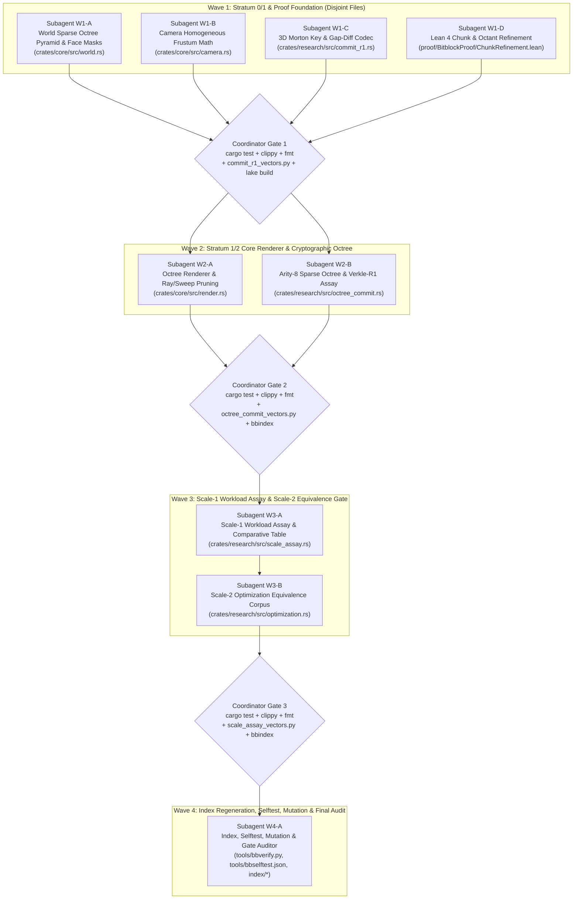

# Multi-Subagent Topological Execution Contract (v5 — Quadruple-Audit Hardened): Sparse Octree World, Cube-Zoom Observer Cut & Authenticated Octree State

> **Target Repository:** `/home/juzz/bitblock` (`main` @ `2df9618`)  
> **Reference Donor Repository:** `/home/juzz/cube-zoom` ([`app/cube-core.js`](file:///home/juzz/cube-zoom/app/cube-core.js#L1-L1260), [`docs/observer-design.md`](file:///home/juzz/cube-zoom/docs/observer-design.md), [`docs/fixed-n.md`](file:///home/juzz/cube-zoom/docs/fixed-n.md), [`rust/cz-core-wasm/src/lib.rs`](file:///home/juzz/cube-zoom/rust/cz-core-wasm/src/lib.rs))  
> **Audit Status:** Hardened across **four full independent adversarial audit passes** (**64 findings closed**: Loop 1 `A1-01..A1-09`, `A2-01..A2-07`, `A3-01..A3-10`; Loop 2 `L2A-01..L2A-06`, `L2B-01..L2B-05`, `L2C-01..L2C-05`; Loop 3 `L3A-01..L3A-05`, `L3B-01..L3B-04`, `L3C-01..L3C-05`; Loop 4 `L4A-01..L4A-03`, `L4B-01..L4B-04`, `L4C-01..L4C-04`).

---

## 1. End-Goal, Architectural Laws & Governance Boundaries

The goal of this multi-subagent contract is to upgrade Bitblock's spatial database, observer query pipeline, and authenticated-state research surface by combining Bitblock's $16 \times 16 \times 16$ bit-packed leaf chunks (`[u64; 64]`, 512 bytes) with four mechanisms adapted from **Cube Zoom**:

1. **Incremental Sparse Octree Occupancy & Dirty Pyramid (`dugDelta` + `bump` from [`cube-core.js:888-907`](file:///home/juzz/cube-zoom/app/cube-core.js#L888-L907))**:
   - Maintain a sparse multi-scale octree pyramid above `World`'s $16^3$ chunks across depths $d \in 1 \dots 8$ (`OCTREE_MAX_DEPTH = 8`, covering $4,096^3$ world units per macro-octant root, with a deterministic forest of macro-octant roots across the full signed `i64` coordinate space).
   - Eliminate the $O(N)$ full-world scan in `World::recompute_bounds()` on boundary deletions in favor of $O(\text{macro-octants})$ root summary folding.
2. **Nested 3D Morton Space-Filling Key & Gap-Encoded Diffs (`morton` / `exportEdits` from [`cube-core.js:38-64, 1052-1091`](file:///home/juzz/cube-zoom/app/cube-core.js#L38-L64))**:
   - Introduce `MortonKeyV1` (`b"bitblock/commit-r1/morton-key/v1"`): a 192-bit 3D Morton-interleaved coordinate key where every 3 bits select one octant child ($0..7$, `bit 2 = x`, `bit 1 = y`, `bit 0 = z`) and the top 60 octant levels (180 bits) identify the exact $16 \times 16 \times 16$ `ChunkCoord` across all signed `i64` values (`(-1).div_euclid(16) == -1`, `i64::MIN`, `i64::MAX`).
   - Build a canonical **Arity-8 Path-Compressed Sparse Cryptographic Octree (`SparseOctreeV1`)** in `bitblock-research` over the full 60-level chunk prefix trie with $16^3$ `ChunkLeafV1` leaves, alongside the self-contained `VERKLE-R1` feasibility report carrier.
3. **Conservative Homogeneous Frustum Culling & Slab-Monotone Ray/Sweep Pruning (`Cut.measure` from [`cube-core.js:1185-1257`](file:///home/juzz/cube-zoom/app/cube-core.js#L1185-L1257))**:
   - Equip `CameraProjection` and `Renderer` with view-space homogeneous frustum culling (before perspective divide, verified with **0 false culls across all 320 seeded `(world, camera)` pairs** in `L2A-06`), and IEEE-754 slab-monotone chunk pruning for `raycast` and `sweep_point` (verified with **0 mismatches across 500 randomized trials** in `L2A-06`).
4. **Bitwise 6-Face Exposure Accounting ("Faces are the cost" from [`docs/fixed-n.md:45`](file:///home/juzz/cube-zoom/docs/fixed-n.md#L45))**:
   - Compute 6-bit exposed-face masks (`FACE_NEG_Z`, `FACE_POS_Z`, `FACE_NEG_X`, `FACE_POS_X`, `FACE_NEG_Y`, `FACE_POS_Y`, matching `render.rs::FACES` order `0..6`) using `[u64; 64]` word operations and `checked_add`/`checked_sub` boundary checks for `SCALE-1` surface-area vs. volume workload accounting.
   - **Audit Law (`A1-02`, `A2-01`)**: `Renderer::draw_faces` must **not** drop individual shared faces between adjacent voxels, because `BARYCENTRIC_EPSILON = -1.0e-10` seam coverage and `plot`'s equal-depth RGB tie-breaker (`0x00989898 < 0x00bdbdbd`) cause 1–3 ULP depth and seam-color differences in 9 of 320 seeded corpus cases. Instead, `Renderer::render` accelerates rendering via **Conservative Homogeneous Chunk Frustum Culling** + existing front-to-back `covering_depth < nearest_possible_depth` occlusion (**0 / 320 mismatches**).

### Non-Claim, Governance & Indexing Rules (`A3-09`, `A3-10`, `L2B-04`, `L2C-03`, `L2C-04`, `L3A-05`, `L3B-01..04`, `L4A-03`, `L4C-01..04`)

- **No Mutation of Canonical Planning Authority or Root Facade**: No subagent in any wave may modify any of the 24 files in `PLANNING_FILES` (`docs/CAPABILITY_TREE.md`, `docs/AUTHENTICATED_STATE_PLAN.md`, `docs/HANDOFF.md`, etc.), any of the 14 files in `FROZEN_TEXT_FILES` enforced by `tools/check_planning_docs.py`, or `src/lib.rs` (`L3A-05`).
- **`bbindex.py` Extraction & Reuse Rules (Mandatory for All Subagents)**:
  1. **Strict Schema Literal, Python Header & No-Arg CLI Rule (`L2B-04`, `L2C-03`, `L3B-04`, `L4A-03`, `L4C-01`)**:
     - `tools/bbindex.py` (`RE_SCHEMA_LIT = re.compile(r'b"(bitblock/[a-z0-9/_-]+)"')`) extracts **every** double-quoted `b"bitblock/[a-z0-9/_-]+"` literal in `.rs` and `.py` files.
     - In `.rs` files, **only the 8 specified protocol schema constants** (`2` in `W1-C`, `5` in `W2-B`, `1` in `W3-A`) may start with `b"bitblock/"`; never write any other `b"bitblock/..."` literal in production or test scope.
     - In `.py` vector scripts (`tools/commit_r1_vectors.py`, `tools/octree_commit_vectors.py`, `tools/scale_assay_vectors.py`), lines 1–2 must start with `#!/usr/bin/env python3\n"""..."""`, every vectored schema must be declared using double quotes `b"bitblock/..."`, and `TAG_DOMAIN = b"bitblock/content-tag/v1"` (plus existing `commit_r1`/`octree_commit` schemas in `scale_assay_vectors.py`) is permitted because those schemas are already declared in `rust_schemas`.
     - **No-Arg Execution (`L4A-03`, `L4C-01`)**: `tools/bbverify.py` runs `python -B tools/<name>_vectors.py` with **zero CLI arguments**. Every `.py` vector script must unconditionally run its entire assertion and negative-control suite under `if __name__ == "__main__":` with zero arguments (ignoring any optional `--self-test` flag; never use `argparse` to gate checks or reject `--self-test`).
  2. **Explicit Single-Module-Path Imports (`L2B-04`, `L3B-03`)**: Always write explicit `use crate::<module>::...;` imports (never `super::...` and never braced `use crate::{mod_a, mod_b};`) so `RE_CRATE_DEP` in `bbindex.py` records the exact dependency edges.
  3. **Zero Unreferenced `pub` Items & Forbidden Dead-Token Guard (`L2C-04`, `L3A-05`, `L3B-02`)**:
     - Every new `pub` item (`fn`, `struct`, `enum`, `const`, `type`) must appear at least once outside its declaration line (in unit tests or callers) so `reuse.unreferenced_pub_items` stays at `3`.
     - **Forbidden Identifier Tokens (`L3A-05`)**: Never use the identifier names `into_challenge`, `into_parts`, or `into_units` anywhere in new or modified code (not even as local variables or test helpers), because those 3 tokens are the existing `unreferenced_pub_items == 3` in `index/reuse.json` and any occurrence would drop the count from `3` to `2`.
  4. **Zero Cross-Module 8-Line Duplication (`L2A-01`, `L2C-01`, `L2C-04`, `L3B-03`)**: Never copy-paste $\ge 8$ lines across modules (`reuse.production_duplicated_lines` is pinned at `407` and `test_duplicated_lines` at `341`).
  5. **Non-Zero Literal `ContentTag` Assertions & Two-Line Test Boundary (`L2C-04`, `L3A-05`, `L4C-04`)**:
     - Every new canonical encoder in `commit_r1.rs`, `octree_commit.rs`, and `scale_assay.rs` must encode big-endian integer fields via `.to_be_bytes()` in production scope and assert its exact `#bb....` `ContentTag` string on a **non-empty, non-zero-coordinate** instance inside its Rust `#[cfg(test)] mod tests` as well as in its Python vector script.
     - **Strict Two-Line Test Header (`L4C-04`)**: Every unit-test module in `.rs` files must begin with the exact two-line header `#[cfg(test)]\nmod tests {` with no intervening attributes, comments, or visibility modifiers so `bbindex.py::test_scope_line` and `bbmutate.py::test_boundary` parse the test boundary identically.

---

## 2. Bottom-Up Topological Wave Architecture (4 Waves, 9 Subagents)



---

## 3. Detailed Subagent Contracts

---

### WAVE 1: Stratum 0/1 & Proof Foundation

---

#### Subagent `W1-A` — `World Sparse Octree Pyramid & Exposed-Face Mask Engineer`

| Field | Specification |
| :--- | :--- |
| **Subagent Type / Model** | `self` (`inherit`) |
| **Capability Node** | `WORLD-0` Spatial Pyramid & Bitwise Surface Accounting |
| **Exclusive Write Lock** | [`crates/core/src/world.rs`](file:///home/juzz/bitblock/crates/core/src/world.rs) |
| **Read-Only Inputs** | [`/home/juzz/cube-zoom/app/cube-core.js`](file:///home/juzz/cube-zoom/app/cube-core.js#L871-L907), [`crates/core/src/render.rs`](file:///home/juzz/bitblock/crates/core/src/render.rs#L927-L952) |

**Deliverables & Technical Contract (`A1-02..06`, `L2A-01`, `L2A-05`, `L3C-01`, `L3C-02`, `L4B-03`):**
1. **Preserve 100% of Existing Public API & Semantics**:
   - `Coord`, `ChunkCoord`, `Bounds`, `BEDROCK_COORD`, `is_bedrock`, `World::new`, `World::empty`, `World::new_with_origin`, `is_on`, `set_on`, `set_off`, `toggle`, `len`, `allocated_chunk_count`, `is_empty`, `bounds`, `iter_on` must retain their exact signatures and behavior.
2. **6-Bit Face Exposure Mask Ordered to Match `render.rs::FACES` (`A1-02`, `A1-03`, `A2-02`)**:
   - Define public face-mask bit constants matching the exact order of `FACES` in `crates/core/src/render.rs:927-952`:
     ```rust
     pub const FACE_NEG_Z: u8 = 1 << 0; // (0, 0, -1)
     pub const FACE_POS_Z: u8 = 1 << 1; // (0, 0, +1)
     pub const FACE_NEG_X: u8 = 1 << 2; // (-1, 0, 0)
     pub const FACE_POS_X: u8 = 1 << 3; // (+1, 0, 0)
     pub const FACE_NEG_Y: u8 = 1 << 4; // (0, -1, 0)
     pub const FACE_POS_Y: u8 = 1 << 5; // (0, +1, 0)
     pub const ALL_FACES_EXPOSED: u8 = 0b0011_1111;
     ```
   - Implement `pub fn exposed_faces(&self, coord: Coord) -> u8`:
     - Returns `0` if `!self.is_on(coord)`.
     - For each of the 6 orthogonal directions, a face bit is `1` (exposed) iff the neighbor coordinate is `off` OR overflows `i64`.
     - **Overflow Guard (`A1-03`)**: Must use `coord.x.checked_sub(1)`, `coord.x.checked_add(1)`, etc. (if `None` at `i64::MIN` or `i64::MAX`, that neighbor is outside `i64` space and therefore `off`, setting the face bit to `1`). For interior local coordinates `1..15` (`1..=14`) along an axis, inspect the bit inside the same `Chunk`'s `bits: [u64; 64]` directly without a `HashMap` lookup.
3. **Per-Chunk Tight Bounds, Raw `[u64; 64]` Accessor & Shared Coordinate Iterator (`A1-04`, `L2A-01`, `L2A-05`, `L3C-01`, `L4B-03`)**:
   - In `Chunk`, maintain tight inclusive `Bounds` of its `on` bits:
     - **First-Bit Initialization (`L3C-01`)**: In `Chunk::set_on(&mut self, index: usize, coord: Coord) -> bool`, when `self.count` transitions from `0` to `1` (`was_empty`), **initialize** `self.bounds = Bounds { min: coord, max: coord }`; only extend `self.bounds` with `min`/`max` per axis when `self.count` was already `>= 1` (never extend a dummy `(0, 0, 0)` bound from `Chunk::empty()`!).
     - **Per-Chunk Boundary Deletion (`L2A-05`)**: On `set_off`, whenever `changed == true` and the chunk remains non-empty (`chunk.count > 0`), update the chunk's tight `Bounds` if `coord` touched that **chunk's** `Bounds` (even when `coord` did not touch global `world.bounds`) by scanning the chunk's 64 `u64` words.
   - Expose:
     - `pub fn chunk_words(&self, chunk: ChunkCoord) -> Option<(u16, &[u64; CHUNK_WORDS])>`
     - `pub fn chunk_bounds(&self, chunk: ChunkCoord) -> Option<Bounds>`
     - `pub fn iter_chunks(&self) -> impl Iterator<Item = (ChunkCoord, u16, Bounds, &[u64; CHUNK_WORDS])> + '_`
     - `pub fn iter_chunk_coords(chunk: ChunkCoord, words: &[u64; CHUNK_WORDS]) -> impl Iterator<Item = Coord> + '_` (`L2A-01`, `L4B-03`: have `World::iter_on` call `World::iter_chunk_coords` and remove the orphaned `Chunk::iter_indices` method so `cargo clippy -- -D warnings` does not fail on `dead_code`).
4. **Cube-Zoom Sparse Octree Pyramid (`A1-04`, `A1-06`, `A3-08`, `L2A-05`, `L3C-02`)**:
   - Define `pub const OCTREE_MAX_DEPTH: u8 = 8;` and public structs:
     ```rust
     #[derive(Clone, Copy, Debug, Eq, Hash, Ord, PartialEq, PartialOrd)]
     pub struct OctantCoord {
         pub depth: u8,
         pub x: i64,
         pub y: i64,
         pub z: i64,
     }

     #[derive(Clone, Copy, Debug, Eq, PartialEq)]
     pub struct OctantSummary {
         pub occupied_bits: usize,
         pub child_mask: u8,
         pub bounds: Bounds,
         pub revision: u64,
     }
     ```
   - At depth $d \in 1 \dots \text{OCTREE\_MAX\_DEPTH}$, a chunk `chunk_coord` maps to `OctantCoord { depth: d, x: chunk_coord.x.div_euclid(1 << d), y: chunk_coord.y.div_euclid(1 << d), z: chunk_coord.z.div_euclid(1 << d) }`.
   - **Parent-to-Child Iteration & Frozen Child Index Bit Order (`A1-06`, `L3C-02`)**:
     - For parent octant `(px, py, pz)` at depth $d \in 1..=8$, its 8 candidate children at depth $d - 1$ (where depth $0$ is `ChunkCoord`) have coordinates `cx = px * 2 + ((child_idx >> 2) & 1) as i64`, `cy = py * 2 + ((child_idx >> 1) & 1) as i64`, `cz = pz * 2 + (child_idx & 1) as i64` for `child_idx in 0..8u8` (safe from `i64` overflow across `i64::MIN..=i64::MAX` because `|chunk_coord| <= 2^59`).
   - **Empty-Octant Removal & Tight Bounds Propagation (`A3-08`, `L2A-05`, `L3C-02`)**:
     - Store a `World`-level `revision_counter: u64` incremented on every effective `set_on` / `set_off`.
     - On every effective `set_on` / `set_off`, walk $d = 1 \dots \text{OCTREE\_MAX\_DEPTH}$ along the modified chunk's ancestor chain: if an octant's `occupied_bits` reaches `0`, remove that `OctantCoord` entry from the pyramid; otherwise recompute its `child_mask`, `occupied_bits`, and tight `bounds` from its present non-empty children at depth $d - 1$, and set `revision = self.revision_counter`.
     - **History-Independent `assert_bedrock_only` (`L3C-02`)**: In `world.rs` internal invariant helpers (`assert_bedrock_only`), check `occupied_bits`, `child_mask`, `bounds`, and `1 <= summary.revision && summary.revision <= world.revision_counter` (do not assert `summary.revision == 1`, because `assert_bedrock_only` is also called after `set_on` + `set_off` reverts).
   - **Fast `recompute_bounds` (`A1-06`, `A3-08`)**: Fold `bounds` across all active level-8 octants (`depth == OCTREE_MAX_DEPTH`).
   - Expose `pub fn octant_summary(&self, coord: OctantCoord) -> Option<OctantSummary>` and `pub fn root_octants(&self) -> impl Iterator<Item = (OctantCoord, OctantSummary)> + '_`, and call every new `pub` item in `world.rs` unit tests.

---

#### Subagent `W1-B` — `Camera Homogeneous Frustum Math Engineer`

| Field | Specification |
| :--- | :--- |
| **Subagent Type / Model** | `self` (`inherit`) |
| **Capability Node** | `OBSERVE-0` Homogeneous View-Frustum Geometry |
| **Exclusive Write Lock** | [`crates/core/src/camera.rs`](file:///home/juzz/bitblock/crates/core/src/camera.rs) |
| **Read-Only Inputs** | [`crates/core/src/render.rs`](file:///home/juzz/bitblock/crates/core/src/render.rs) |

**Deliverables & Technical Contract (`A2-05`, `A2-06`, `A3-01`, `L2A-02`, `L2A-06`):**
1. Preserve all existing `Camera`, `CameraProjection`, `Vec3`, `Ray`, and `ProjectedPoint` methods and constants (`ONE_PIXEL_EPSILON`) untouched.
2. Promote `CameraProjection` and `Camera::projection_for_viewport` from `pub(crate)` to `pub` (`A3-01`, `A2-06`).
3. Implement `pub fn aabb_definitely_outside_frustum(&self, min: Vec3, max: Vec3) -> bool` on `CameraProjection` (`L2A-02`, `L2A-06`):
   - First check `if !bounds_are_valid(min, max) { return false; }` (matching `bounds_fit_one_pixel` at `camera.rs:240`).
   - Compute the 8 corners $c_i$ of `[min, max]`. For each corner, compute `rel = c_i - self.position`, `x_cam = rel.dot(self.basis.right)`, `y_cam = rel.dot(self.basis.up)`, `z_cam = rel.dot(self.basis.forward)`.
   - Return `true` if and only if **all 8 corners** satisfy at least one of the 5 single-plane rejection predicates:
     1. **Behind camera plane**: all 8 corners have `z_cam <= 0.0`, OR
     2. **Strictly left of viewport**: all 8 corners have `z_cam > 0.0` and `self.focal_length * x_cam < -(self.half_width + 1.0) * z_cam`, OR
     3. **Strictly right of viewport**: all 8 corners have `z_cam > 0.0` and `self.focal_length * x_cam > +(self.half_width + 1.0) * z_cam`, OR
     4. **Strictly above viewport**: all 8 corners have `z_cam > 0.0` and `self.focal_length * y_cam > +(self.half_height + 1.0) * z_cam`, OR
     5. **Strictly below viewport**: all 8 corners have `z_cam > 0.0` and `self.focal_length * y_cam < -(self.half_height + 1.0) * z_cam`.
   - Do **not** add `aabb_projected_screen_box` or any other unused helper method (`L2A-02`).
4. Add unit tests in `camera.rs` exercising `aabb_definitely_outside_frustum` across in-frustum, behind-camera, straddling-`z_cam = 0.0`, left/right/top/bottom-outside, and invalid-bounds cases.

---

#### Subagent `W1-C` — `3D Morton & Hilbert Spatial Key Architect`

| Field | Specification |
| :--- | :--- |
| **Subagent Type / Model** | `self` (`inherit`) |
| **Capability Node** | `COMMIT-R1` Spatial Key Profile (`Open Decision #7` in [`docs/AUTHENTICATED_STATE_PLAN.md`](file:///home/juzz/bitblock/docs/AUTHENTICATED_STATE_PLAN.md#L1385)) |
| **Exclusive Write Lock** | [`crates/research/src/commit_r1.rs`](file:///home/juzz/bitblock/crates/research/src/commit_r1.rs), [`tools/commit_r1_vectors.py`](file:///home/juzz/bitblock/tools/commit_r1_vectors.py) |
| **Read-Only Inputs** | [`/home/juzz/cube-zoom/app/cube-core.js`](file:///home/juzz/cube-zoom/app/cube-core.js#L38-L64), [`docs/AUTHENTICATED_STATE_PLAN.md`](file:///home/juzz/bitblock/docs/AUTHENTICATED_STATE_PLAN.md) |

**Deliverables & Technical Contract (`L2B-05`, `L2C-03`, `L2C-04`, `L3A-01`, `L3A-05`, `L3B-02`):**
1. Preserve existing `CoordinateKeyV1` and all existing `COMMIT-R1` tests/tags untouched. Add **only** the 2 new `b"bitblock/..."` schema literals below (`L2C-03`).
2. **Exact MSB-First Bit-Packing for `MortonKeyV1` (`L3A-01`, `L3B-02`)**:
   - Schema: `pub const MORTON_KEY_V1_SCHEMA: &[u8] = b"bitblock/commit-r1/morton-key/v1";` (`24` bytes / `192` bits, `TagKind::World`).
   - Map each signed coordinate $c \in \{x, y, z\}$ to $u = (c \text{ as } u64) \oplus \text{0x8000\_0000\_0000\_0000}$.
   - For octant level $L \in 0..64$ ($b = 63 - L$) and axis offset $a \in \{0, 1, 2\}$ ($0 \mapsto u_x, 1 \mapsto u_y, 2 \mapsto u_z$), bit position $\text{bit\_pos} = 3L + a \in 0..192$ is packed MSB-first into `bytes[bit_pos / 8]` at shift `7 - (bit_pos % 8)`:
     ```rust
     bytes[bit_pos / 8] |= (((u_axis >> (63 - L)) & 1) as u8) << (7 - (bit_pos % 8));
     ```
   - Expose:
     - `pub fn from_coord(coord: Coord) -> Self` and `pub const fn from_bytes(bytes: [u8; 24]) -> Self`
     - `pub fn to_coord(self) -> Coord`
     - `pub const fn as_bytes(&self) -> &[u8; 24]`
     - `pub fn octant_at(&self, level: u8) -> u8`: for `level in 0..64`, reads MSB bits `base = 3 * (level as usize)`, `base + 1`, `base + 2` via `let bit = |p: usize| (self.0[p / 8] >> (7 - (p % 8))) & 1;` and returns `(bit(base) << 2) | (bit(base + 1) << 1) | bit(base + 2)` (returning `0` if `level >= 64`).
     - `pub fn chunk_prefix_180b(&self) -> [u8; 23]`: copies `out[0..22].copy_from_slice(&self.0[0..22]); out[22] = self.0[22] & 0xF0; out`.
     - `pub fn tag(&self) -> ContentTag` (`hash_canonical(TagKind::World, MORTON_KEY_V1_SCHEMA, 24, ...)`).
3. Add `MortonGapStreamV1` (`pub const MORTON_GAP_STREAM_V1_SCHEMA: &[u8] = b"bitblock/commit-r1/morton-gap-stream/v1";`, `TagKind::Receipt`) (`L2B-05`):
   - Encodes a slice/set of `Coord`s sorted strictly ascending by `MortonKeyV1`:
   - When `count == 0`, the canonical payload is 4 bytes (`0u32.to_be_bytes()`, `encoded_len() == 4`).
   - When `count >= 1`, payload begins with `count_u32_be` (`4` bytes), then entry `0` as its full 24-byte `MortonKeyV1`, and each entry `i in 1..count` as `k = shared_prefix_bytes_u8` (`1` byte, must satisfy `k < 24`) followed by `24 - k` suffix bytes where **`suffix[0] > prev[k]`** (which simultaneously enforces strict ascending order, duplicate rejection, and maximal prefix length). Decoder must also reject trailing bytes (`cursor != bytes.len()`).
   - Pre-compute `pub fn encoded_len(&self) -> usize` and pass `self.encoded_len() as u64` to `protocol::hash_canonical`.
4. **Unit-Test Coverage & Non-Zero Mutation Pin (`L2C-04`, `L3A-05`, `L3B-02`)**:
   - Call every new `pub` method (`from_coord`, `from_bytes`, `to_coord`, `as_bytes`, `octant_at`, `chunk_prefix_180b`, `tag`, `encoded_len`) in `commit_r1.rs` unit tests (`L3B-02`).
   - Assert exact literal `#bb....` `ContentTag` strings for a non-zero `MortonKeyV1` AND a non-empty `MortonGapStreamV1` (`count >= 2`, so `count_u32.to_be_bytes()` is non-zero and killed by `bbmutate.py`, `L3A-05`) in both `commit_r1.rs` unit tests and `tools/commit_r1_vectors.py`.

---

#### Subagent `W1-D` — `Lean 4 Chunk & Octant Refinement Prover`

| Field | Specification |
| :--- | :--- |
| **Subagent Type / Model** | `self` (`inherit`) |
| **Capability Node** | `REFINE-1@world` (`PS-022:REFINE-1@world=READY`) |
| **Exclusive Write Lock** | `proof/BitblockProof/ChunkRefinement.lean` (new), [`proof/BitblockProof.lean`](file:///home/juzz/bitblock/proof/BitblockProof.lean) |
| **Read-Only Inputs** | [`crates/core/src/world.rs`](file:///home/juzz/bitblock/crates/core/src/world.rs#L322-L346), [`proof/BitblockProof/World.lean`](file:///home/juzz/bitblock/proof/BitblockProof/World.lean), [`proof/lakefile.toml`](file:///home/juzz/bitblock/proof/lakefile.toml) |

**Deliverables & Technical Contract (`A1-01`, `A3-05`, `A3-10`, `L2B-02`, `L3C-05`):**
1. Create `proof/BitblockProof/ChunkRefinement.lean` inside `namespace BitblockProof` (`import BitblockProof.World`) and add `import BitblockProof.ChunkRefinement` to `proof/BitblockProof.lean` (Zero `sorry`, zero `axiom`, zero compiler warnings).
2. **Use `x / 16` and `x % 16` for `omega` Compatibility (`L2B-02`)**:
   - In Lean 4 (`v4.33.0`), `omega` treats raw `Int.ediv` / `Int.emod` as uninterpreted symbols, whereas `/` and `%` on `Int` are definitionally equal (`rfl`) to `Int.ediv` and `Int.emod` and natively understood by `omega`. Define:
     ```lean
     def inI64Bounds (x : Int) : Prop :=
       -9223372036854775808 ≤ x ∧ x ≤ 9223372036854775807

     def splitAxis (x : Int) : Int × Nat := (x / 16, (x % 16).toNat)
     def joinAxis (cx : Int) (lx : Nat) : Int := cx * 16 + Int.ofNat lx

     theorem splitAxis_eq_ediv_emod (x : Int) :
         splitAxis x = (x.ediv 16, (x.emod 16).toNat) := rfl
     ```
   - Prove `joinAxis_splitAxis`, `splitAxis_local_lt`, `splitAxis_joinAxis`, and `chunk_coord_bounds` (for `inI64Bounds x`, `-576460752303423488 ≤ (splitAxis x).1 ∧ (splitAxis x).1 ≤ 576460752303423487`) via `simp [splitAxis, joinAxis, inI64Bounds]; omega`.
3. **3D Local Index Bijection Without Unused-Hypothesis Warnings (`L2B-02`)**:
   - Define `localIndex (lx ly lz : Nat) : Nat := lx + 16 * (ly + 16 * lz)` and `unflattenIndex (idx : Nat) : Nat × Nat × Nat := (idx % 16, (idx / 16) % 16, idx / 256)`.
   - Prove `theorem localIndex_lt (lx ly lz : Nat) (hx : lx < 16) (hy : ly < 16) (hz : lz < 16) : localIndex lx ly lz < 4096` and `theorem unflattenIndex_localIndex (lx ly lz : Nat) (hx : lx < 16) (hy : ly < 16) : unflattenIndex (localIndex lx ly lz) = (lx, ly, lz)` (omitting unused `hz` on `unflattenIndex_localIndex` so Lean emits zero unused-variable warnings).
4. **Named Abstraction Function & Powered Negative Control (`A3-10`, `L2B-02`)**:
   - Define `abbrev ChunkCoord := Int × Int × Int`, `concreteSplitCoord (c : Coord) : ChunkCoord × Nat`, and `abstractChunkCoord (p : ChunkCoord × Nat) : Coord`, and prove `theorem abstractChunkCoord_concreteSplitCoord (c : Coord) : abstractChunkCoord (concreteSplitCoord c) = c`.
   - Prove a powered negative-control mutant theorem `truncDivSplit_breaks_negative_coord` showing that truncated division/modulo (`Int.tdiv`/`Int.tmod` with `.toNat` at `x = -1`) fails reconstruction (`joinAxis ((-1 : Int).tdiv 16) ((-1 : Int).tmod 16).toNat ≠ -1`).

---

### WAVE 2: Stratum 1 & 2 Core Renderer & Cryptographic Octree

Wave 2 starts **only after Coordinator Gate 1 passes**.

---

#### Subagent `W2-A` — `Octree Renderer & Slab-Monotone Ray/Sweep Engineer`

| Field | Specification |
| :--- | :--- |
| **Subagent Type / Model** | `self` (`inherit`) |
| **Capability Node** | `OBSERVE-0` / `SCALE-2` Accelerated Observation & Spatial Queries |
| **Exclusive Write Lock** | [`crates/core/src/render.rs`](file:///home/juzz/bitblock/crates/core/src/render.rs) |
| **Read-Only Inputs** | [`crates/core/src/world.rs`](file:///home/juzz/bitblock/crates/core/src/world.rs), [`crates/core/src/camera.rs`](file:///home/juzz/bitblock/crates/core/src/camera.rs) |

**Deliverables & Technical Contract (`A1-02`, `A2-01..06`, `A3-02`, `A3-09`, `L2A-01..06`, `L2C-01`, `L3B-01`, `L3B-02`, `L4B-03`):**
1. **Zero Changes to `renderer_profile_tag()`, `crosshair_policy_tag()`, or `render.rs`'s `//!` Doc Comment (`A3-09`, `L3B-01`)**:
   - Keep `crates/core/src/render.rs`'s `//!` module doc comment (`lines 1–6`) **byte-for-byte untouched** (shortening `render.rs`'s doc comment would reduce `len(render["terms"])` and allow `render` to overtake `frame` on `"canonical framebuffer bytes"` in `bbgraph.py selftest`, `L3B-01`).
   - Do **not** use the words `"canonical"`, `"bytes"`, or `"framebuffer"` in any new `pub` item identifier in `render.rs`.
2. **Unconditional `reference_traversal` Field & Public Setter (`A3-02`, `L2A-04`, `L3B-02`, `L4B-03`)**:
   - Remove `#[cfg(test)]` from `reference_traversal: bool` in **both** `struct Renderer` (`render.rs:169`) and `Renderer::new` (`render.rs:259`), defaulting to `false` (`L4B-03`).
   - Expose `pub fn set_reference_traversal(&mut self, enabled: bool)` and `pub const fn is_reference_traversal(&self) -> bool` (and call `renderer.is_reference_traversal()` in `render.rs` unit tests per `L3B-02`).
   - **Crucial (`L2A-04`)**: Replace both `#[cfg(test)]` and `#[cfg(not(test))]` definitions of `optimized_traversal` at `render.rs:409-417` with a single unconditional method:
     ```rust
     const fn optimized_traversal(&self) -> bool {
         !self.reference_traversal
     }
     ```
3. **Conservative Homogeneous Chunk Frustum Culling in `Renderer::render` (`A1-02`, `A2-01`, `L2A-01`, `L2A-06`)**:
   - Also promote `pub fn bounds_aabb(bounds: Bounds) -> (Vec3, Vec3)` to `pub` so `scale_assay.rs` can compute `(cmin, cmax)` without duplicating `bounds_aabb` (`L3A-04`).
   - Keep `draw_faces` rasterizing all 6 faces unchanged (`0 / 320` mismatches).
   - In `Renderer::render`, when `self.optimized_traversal()` is `true`:
     - Iterate over allocated chunks via `world.iter_chunks()`.
     - For each `(chunk_coord, _count, chunk_bounds, words)`, compute `(chunk_min, chunk_max) = bounds_aabb(chunk_bounds)`.
     - If `projection.aabb_definitely_outside_frustum(chunk_min, chunk_max)` is `true`:
       - In `#[cfg(test)]`, if `self.verify_hidden_bits` is `true`, verify the culled chunk writes nothing by temporarily setting `self.verify_hidden_bits = false`, cloning `(self.pixels, self.depth, self.world_pixels, self.hidden_bits)`, calling `self.draw_bit(projection, coord)` for `coord in crate::world::World::iter_chunk_coords(chunk_coord, words)`, asserting `pixels`, `depth`, and `world_pixels` are unchanged, and restoring `hidden_bits` and `verify_hidden_bits = true` (`L2A-06`).
       - Continue (`skip` the chunk in $O(1)$).
     - Otherwise, for `coord in crate::world::World::iter_chunk_coords(chunk_coord, words)`, compute `key = projection.view_depth(coord_center(coord))` and push `(key, coord)` into `self.keyed`, then bucket-sort `self.order` as before.
4. **Public `ray_aabb_entry_distance` & Slab-Monotone Chunk-Pruned `raycast` / `sweep_point` (`A2-03`, `A2-04`, `L2A-01`, `L2A-03`, `L2C-01`)**:
   - Expose a public wrapper around `box_interval` (`render.rs:844`):
     ```rust
     pub fn ray_aabb_entry_distance(ray: Ray, min: Vec3, max: Vec3) -> Option<f64>
     ```
     which calls `box_interval(ray.origin, ray.direction, min, max)`, returns `None` if `interval.exit < 0.0`, and returns `Some(if interval.entry >= 0.0 { interval.entry } else { 0.0 })` otherwise.
   - In `raycast(world: &World, ray: Ray) -> Option<Hit>`:
     - Iterate `(chunk_coord, _count, chunk_bounds, words)` in `world.iter_chunks()`.
     - Compute `(cmin, cmax) = bounds_aabb(chunk_bounds)`. Call `let Some(chunk_entry) = ray_aabb_entry_distance(ray, cmin, cmax) else { continue; };`.
     - If `best.is_some_and(|current| chunk_entry > current.distance)` (strict IEEE-754 `>`, **never** `>=` and **never** `total_cmp`), skip the chunk!
     - Otherwise test each `coord in crate::world::World::iter_chunk_coords(chunk_coord, words)`.
   - In `sweep_point(world: &World, start: Vec3, delta: Vec3) -> Option<SweepHit>`:
     - Iterate `(chunk_coord, _count, chunk_bounds, words)` in `world.iter_chunks()`.
     - Compute `(cmin, cmax) = bounds_aabb(chunk_bounds)`. Call `let Some(chunk_fraction) = segment_box_entry_fraction(start, delta, cmin, cmax) else { continue; };`.
     - If `best.is_some_and(|(best_fraction, _)| chunk_fraction > best_fraction)` (strict IEEE-754 `>`), skip the chunk!
     - Otherwise test each `coord in crate::world::World::iter_chunk_coords(chunk_coord, words)`.
   - Expose `pub fn raycast_reference(world: &World, ray: Ray) -> Option<Hit>` and `pub fn sweep_point_reference(world: &World, start: Vec3, delta: Vec3) -> Option<SweepHit>` (using `world.iter_on()`) and test both in `render.rs` unit tests (including the `-0.0` boundary and `start = -0.5 - 2^-52, delta = 2.0` counterexamples).

---

#### Subagent `W2-B` — `Arity-8 Cryptographic Octree & Verkle-R1 Feasibility Architect`

| Field | Specification |
| :--- | :--- |
| **Subagent Type / Model** | `self` (`inherit`) |
| **Capability Nodes** | `COMMIT-R1` (Spatial Octree Extension) + `VERKLE-R1@feasibility` (`PS-016`, `PS-017`) |
| **Exclusive Write Lock** | `crates/research/src/octree_commit.rs` (new), `tools/octree_commit_vectors.py` (new), [`crates/research/src/lib.rs`](file:///home/juzz/bitblock/crates/research/src/lib.rs) |
| **Read-Only Inputs** | [`crates/research/src/commit_r1.rs`](file:///home/juzz/bitblock/crates/research/src/commit_r1.rs), [`crates/core/src/world.rs`](file:///home/juzz/bitblock/crates/core/src/world.rs), [`docs/CAPABILITY_TREE.md`](file:///home/juzz/bitblock/docs/CAPABILITY_TREE.md#L535-L558) |

**Deliverables & Technical Contract (`A1-07`, `A1-09`, `L2B-01..04`, `L2C-02..04`, `L3A-01..03`, `L3A-05`, `L3B-03`, `L3C-03`, `L4A-01`, `L4A-02`, `L4B-01`, `L4B-02`):**
1. **Alphabetical Module Declaration, Required Imports & Clippy Compliance (`L2C-02`, `L3B-03`, `L3C-03`, `L4A-02`, `L4B-02`)**:
   - Insert `pub mod octree_commit;` in `crates/research/src/lib.rs` alphabetically between `pub mod local_bounds;` and `pub mod optimization;`.
   - Start `crates/research/src/octree_commit.rs` with a `//!` doc comment (without `"framebuffer"`), use explicit `use crate::commit_r1::MortonKeyV1;`, `use crate::protocol::...;`, and `use crate::world::...;` imports (`L3B-03`), and define **only** the 5 `b"bitblock/..."` schema constants below (`L2C-03`).
   - **No Morton Duplication (`L3B-03`)**: Compute chunk prefixes and octant indices by calling `MortonKeyV1::from_coord(Coord::new(chunk.x * 16, chunk.y * 16, chunk.z * 16)).chunk_prefix_180b()` and `.octant_at(...)` rather than re-implementing Morton bit-interleaving.
   - **Clippy `large_enum_variant` Guard (`L4B-02`)**: Add `#[allow(clippy::large_enum_variant)]` (or box `ChunkLeafV1`) on any enum holding `ChunkLeafV1` (`538` bytes) alongside smaller variants so `cargo clippy -- -D warnings` passes cleanly.
   - **Public `SparseOctreeV1` API & Deterministic Morton-Sorted Construction (`L3B-03`, `L3C-03`, `L4A-02`)**:
     - Expose `pub struct SparseOctreeV1`, `pub fn empty() -> Self`, `pub fn from_world(world: &World) -> Self`, `pub fn root(&self) -> &OctreeRootV1`, `pub fn root_tag(&self) -> ContentTag`, `pub fn prove(&self, coord: Coord) -> OctreePointProofV1`, and `pub fn verify_proof(root: &OctreeRootV1, proof: &OctreePointProofV1) -> Option<bool>`.
     - **`from_world` Construction (`L4A-02`)**: Build one `ChunkLeafV1` per allocated chunk in `world.iter_chunks()` and **sort `leaves` strictly ascending by `leaf.chunk_prefix_180b`** (3D Morton order, **never** by `ChunkCoord` lexicographical order!). If `leaves.is_empty()`, return `SparseOctreeV1::empty()` (`tree_state_u8 = 0, occupied_chunks_u64 = 0, occupied_bits_u64 = 0, root_node_digest = [0u8; 32]`); if `leaves.len() == 1`, set `tree_state_u8 = 1, occupied_chunks_u64 = 1, occupied_bits_u64 = leaves[0].occupied_count_u16 as u64, root_node_digest = leaves[0].tag().digest()`; if `leaves.len() >= 2`, set `tree_state_u8 = 2`, compute `branch_depth = common_octant_prefix_len(&leaves[0].chunk_prefix_180b, &leaves[leaves.len() - 1].chunk_prefix_180b) as u8`, `prefix_bits_180b = mask_prefix_180b(leaves[0].chunk_prefix_180b, branch_depth)`, partition `leaves` into contiguous sub-slices by `octant = octant_at_prefix(&leaf.chunk_prefix_180b, branch_depth)` (`0..8`), and recursively build child nodes (`sub_slice.len() == 1` -> `ChunkLeafV1`, `sub_slice.len() >= 2` -> `OctreeInternalNodeV1`).
2. **Exact Bit/Prefix Helpers & Byte Layouts for All 5 Schemas (`L2B-01..04`, `L3A-01..03`, `L4A-01`, `L4B-01`)**:
   - **Note on `ContentTag::digest(self)` (`L4A-01`, `L4B-01`)**: In `crates/core/src/protocol.rs:180`, `pub const fn digest(self) -> [u8; 32]` returns `[u8; 32]` **by value** (do not prefix `.digest()` with `*`).
   - **Canonical 180-Bit Prefix Helpers (`L3A-01`, `L4B-03`)**:
     - `octant_at_prefix(prefix: &[u8; 23], depth: u8) -> u8` (`depth in 0..60`): reads MSB bits `base = 3 * (depth as usize)`, `base + 1`, `base + 2` via `let bit = |p: usize| (prefix[p / 8] >> (7 - (p % 8))) & 1;` and returns `(bit(base) << 2) | (bit(base + 1) << 1) | bit(base + 2)`.
     - `mask_prefix_180b(raw: [u8; 23], branch_depth: u8) -> [u8; 23]` (`branch_depth in 0..60`): initialize `let mut out = [0u8; 23];`, let `keep_bits = (branch_depth as usize) * 3` (`0..=177`), `full_bytes = keep_bits / 8` (`0..=22`), `rem = keep_bits % 8` (`0..8`). Copy `out[0..full_bytes].copy_from_slice(&raw[0..full_bytes]);` and if `rem != 0 { out[full_bytes] = raw[full_bytes] & (!0u8 << (8 - rem)); }`.
     - `common_octant_prefix_len(a: &[u8; 23], b: &[u8; 23]) -> usize`: returns the smallest `d in 0..60` where `octant_at_prefix(a, d as u8) != octant_at_prefix(b, d as u8)`, or `60` if all 60 octant trios match.
   1. `pub const OCTREE_CHUNK_LEAF_V1_SCHEMA: &[u8] = b"bitblock/octree-commit/chunk-leaf/v1";` (`TagKind::World`, fixed `payload_len = 537`):
      - `chunk_prefix_180b: [u8; 23]` (top 180 bits of `MortonKeyV1`; rejects if `(chunk_prefix_180b[22] & 0x0F) != 0`),
      - `occupied_count_u16: u16` (big-endian; rejects if `occupied_count_u16 == 0 || occupied_count_u16 > 4096` or `occupied_count_u16 as u32 != popcount(bits_512b)`),
      - `bits_512b: [u8; 512]` (64 `u64` words from `world.chunk_words(chunk_coord)` encoded via `word.to_be_bytes()`, where `local_index = lx + 16 * (ly + 16 * lz)` lives at `word_index = local_index / 64`, `bit_index = local_index % 64`, byte `word_index * 8 + (7 - bit_index / 8)`, mask `1u8 << (bit_index % 8)`).
   2. `pub const OCTREE_INTERNAL_NODE_V1_SCHEMA: &[u8] = b"bitblock/octree-commit/internal-node/v1";` (`TagKind::World`, `payload_len = 25 + 32 * (child_mask.count_ones() as u64)`):
      - `branch_depth: u8` (`0..60`),
      - `prefix_bits_180b: [u8; 23]` (must equal `mask_prefix_180b(prefix_bits_180b, branch_depth)`),
      - `child_mask: u8` (must satisfy `child_mask.count_ones() >= 2`),
      - $k = \text{child\_mask.count\_ones()}$ 32-byte child digests (`child_tag.digest()`) in ascending octant index order `0..8`.
   3. `pub const OCTREE_ROOT_V1_SCHEMA: &[u8] = b"bitblock/octree-commit/root/v1";` (`TagKind::World`, fixed `payload_len = 49`):
      - `tree_state_u8: u8` (`0` empty: `occupied_chunks_u64 == 0 && occupied_bits_u64 == 0 && root_node_digest == [0u8; 32]`; `1` single chunk leaf: `occupied_chunks_u64 == 1 && (1..=4096).contains(&occupied_bits_u64)`; `2` $\ge 2$ chunks: `occupied_chunks_u64 >= 2 && occupied_bits_u64 >= occupied_chunks_u64`),
      - `occupied_chunks_u64: u64` (big-endian),
      - `occupied_bits_u64: u64` (big-endian),
      - `root_node_digest: [u8; 32]`.
   4. `pub const OCTREE_POINT_PROOF_V1_SCHEMA: &[u8] = b"bitblock/octree-commit/point-proof/v1";` (`TagKind::Receipt`, `payload_len = self.encoded_len() as u64`) (`L2B-03`, `L3A-02`, `L3C-03`, `L4A-01`, `L4B-01`):
      - Wire layout:
        - `query_coord_x_i64_be: [u8; 8] || query_coord_y_i64_be: [u8; 8] || query_coord_z_i64_be: [u8; 8]` (`24` bytes),
        - `steps_count_u8: u8` (`0..=60`), followed by `steps_count_u8` parent steps ordered **root-to-leaf** (`steps[0].branch_depth < steps[1].branch_depth < ... < steps.last().branch_depth < 60`), each encoded as `branch_depth: u8 || prefix_bits_180b: [u8; 23] || child_mask: u8 || sibling_digests: [[u8; 32]; child_mask.count_ones() - 1]` (siblings in ascending octant order `0..8` excluding `query_key.octant_at(branch_depth)`). Every `step` must satisfy `step.prefix_bits_180b == mask_prefix_180b(step.prefix_bits_180b, step.branch_depth)`, `step.child_mask.count_ones() >= 2`, `common_octant_prefix_len(&step.prefix_bits_180b, &query_key.chunk_prefix_180b()) >= step.branch_depth as usize`, and `(step.child_mask & (1 << query_key.octant_at(step.branch_depth))) != 0`.
        - `terminal_tag_u8: u8`:
          - `0` (`EmptyTree`): `0` extra bytes (valid iff `root.tree_state_u8 == 0 && steps.is_empty()`, terminal digest `[0u8; 32]`, returns `Some(false)`),
          - `1` (`ChunkLeaf(leaf)`): `537` bytes (`ChunkLeafV1` payload; valid iff (`root.tree_state_u8 == 1 && steps.is_empty() && root.occupied_bits_u64 == leaf.occupied_count_u16 as u64`) OR (`root.tree_state_u8 == 2 && !steps.is_empty()` with `common_octant_prefix_len(&leaf.chunk_prefix_180b, &query_key.chunk_prefix_180b()) >= (last_branch_depth as usize) + 1`)). Terminal digest is `leaf.tag().digest()`. Once root hash-chain matches, returns `Some(false)` if `leaf.chunk_prefix_180b != query_key.chunk_prefix_180b()`, otherwise returns `Some(bit == 1)` for `query_coord`'s bit in `leaf.bits_512b`.
          - `2` (`InternalNode(node)`): `25 + 32 * k` bytes (`OctreeInternalNodeV1` payload; valid iff `root.tree_state_u8 == 2`, `node` is a valid canonical `OctreeInternalNodeV1`, if `!steps.is_empty()` then `last_branch_depth < node.branch_depth` AND `common_octant_prefix_len(&node.prefix_bits_180b, &query_key.chunk_prefix_180b()) >= (last_branch_depth as usize) + 1`, and EITHER `common_octant_prefix_len(&node.prefix_bits_180b, &query_key.chunk_prefix_180b()) < node.branch_depth as usize` OR `(node.child_mask & (1 << query_key.octant_at(node.branch_depth))) == 0`). Terminal digest is `node.tag().digest()`, returns `Some(false)`.
      - **Bottom-Up Hash-Chain Folding (`L3A-02`)**: Fold `current_digest` from the terminal node through `steps.iter().rev()` by splicing `current_digest` at `query_key.octant_at(step.branch_depth)` and `step.sibling_digests` at the remaining set bits of `step.child_mask` in ascending octant order `0..8` to construct `OctreeInternalNodeV1` and update `current_digest = parent.tag().digest()`, then require `current_digest == root.root_node_digest`.
   5. `pub const VERKLE_R1_FEASIBILITY_V1_SCHEMA: &[u8] = b"bitblock/octree-commit/verkle-r1-feasibility/v1";` (`TagKind::Receipt`, fixed `payload_len = 198` bytes) (`L2B-04`, `L2C-03`, `L3A-03`, `L4A-02`):
      - Do **not** use any `b"bitblock/..."` literal inside `VerkleR1FeasibilityReportV1`.
      - Pin `VerkleR1FeasibilityReportV1::canonical()` (`198` bytes = `2 + 2 + 32 + 32 + 32 + 1 + 1 + 4 * 24`):
        - `descriptor_version_u16 = 1`, `arity_u16 = 256`,
        - `field_modulus_bytes = [0x1c, 0xf4, 0x5c, 0x91, 0x4b, 0x7a, 0x82, 0xd3, 0x6e, 0x10, 0x99, 0x54, 0x2a, 0xb1, 0x7c, 0x38, 0x05, 0x6f, 0xe2, 0x41, 0x8d, 0x93, 0xc7, 0x1a, 0x50, 0xbe, 0x44, 0x29, 0x73, 0x0f, 0xa6, 0x01]`,
        - `profile_descriptor_digest = [0x41; 32]`, `domain_registry_id_digest = [0x52; 32]`,
        - `trusted_setup_required_u8 = 0`, `subgroup_check_required_u8 = 1`,
        - 4 candidate tuples `(point_witness_bytes_u64, single_edit_hashes_u64, chunk_batch_64_hashes_u64)` encoded in big-endian:
          1. `BinaryPatricia`: `(6_144, 192, 12_288)`
          2. `SparseMerkle192`: `(6_169, 192, 12_288)`
          3. `SparseOctreeChunkLeaf`: `(13_977, 61, 61)`
          4. `VerkleOctree256`: `(576, 17, 17)`
        - Verified canonical `ContentTag`: `#bb.receipt.sha256.j3xacn27gfhq6f4wrxvn5upcvvufq5soltxncytvglb2recohp7a`.
3. **Unit-Test Coverage & Non-Zero Mutation Pin (`L2C-04`, `L3A-05`, `L4A-02`)**:
   - Assert exact literal `#bb....` `ContentTag` strings for all 5 schemas on non-empty, multi-chunk (`tree_state_u8 == 2`), non-zero-`query_coord` instances in `octree_commit.rs` unit tests and `tools/octree_commit_vectors.py` (including `Empty` root `#bb.world.sha256.5obybgly3kj2356d426gjijnuezscj3rz556r2el3xue7mccedea` and `SingleOrigin` root `#bb.world.sha256.lmjzqddt5hcdszpiwkaf3ckxdtk25mcdm4go4zav6i3r4gn6kksa`).

---

### WAVE 3: Scale-1 Workload Assay & Scale-2 Equivalence Gate

Wave 3 starts **only after Coordinator Gate 2 passes**.

---

#### Subagent `W3-A` — `Scale-1 Workload Assay & Comparative Synthesis Engineer`

| Field | Specification |
| :--- | :--- |
| **Subagent Type / Model** | `self` (`inherit`) |
| **Capability Nodes** | `SCALE-1` (`PS-051:SCALE-1@base=READY`) + Comparative Assay Synthesis |
| **Exclusive Write Lock** | `crates/research/src/scale_assay.rs` (new), `tools/scale_assay_vectors.py` (new), [`crates/research/src/lib.rs`](file:///home/juzz/bitblock/crates/research/src/lib.rs) |
| **Read-Only Inputs** | `crates/core/src/world.rs`, `crates/core/src/camera.rs`, `crates/core/src/render.rs`, `crates/research/src/commit_r1.rs`, `crates/research/src/octree_commit.rs` |

**Deliverables & Technical Contract (`A2-07`, `L2A-03`, `L2B-04`, `L2C-01..04`, `L3A-04`, `L3B-03`, `L3C-03`, `L4A-01`, `L4B-01`):**
1. **Alphabetical Module Declaration & Required Imports (`L2C-02`, `L3B-03`)**:
   - Insert `pub mod scale_assay;` in `crates/research/src/lib.rs` alphabetically between `pub mod replay_evidence;` and `pub mod sequential;`.
   - Start `scale_assay.rs` with a `//!` doc comment (without `"framebuffer"`), use explicit single-module imports `use crate::camera::...;`, `use crate::commit_r1::{MerklePatriciaTrie, SparseMerkleTree};`, `use crate::octree_commit::SparseOctreeV1;`, `use crate::protocol::...;`, `use crate::render::...;`, `use crate::world::...;` (`L3B-03`), and define **only** the 1 `b"bitblock/..."` schema constant below (`L2C-03`).
2. **Public Workload Builder API & Exact Fixed Byte Layout (`payload_len = 929`) for `ScaleWorkloadReportV1` (`L2A-03`, `L2B-04`, `L2C-01`, `L3A-04`, `L3C-03`, `L4A-01`, `L4B-01`)**:
   - Schema: `pub const SCALE_WORKLOAD_REPORT_V1_SCHEMA: &[u8] = b"bitblock/scale-assay/workload-report/v1";` (`TagKind::Receipt`, fixed `payload_len = 4 + 5 * 185 = 929` bytes).
   - Export public workload ID enum and builder so `W3-B` (`optimization.rs`) calls them directly (`L3A-04`, `L3C-03`):
     ```rust
     #[derive(Clone, Copy, Debug, Eq, PartialEq, Ord, PartialOrd, Hash)]
     pub enum ScaleWorkloadId {
         SingleOrigin = 0,
         DenseCube16 = 1,
         HollowShell16 = 2,
         NegativeChunkCluster = 3,
         SparseFarExtrema = 4,
     }
     pub const ALL_SCALE_WORKLOADS: [ScaleWorkloadId; 5] = [
         ScaleWorkloadId::SingleOrigin,
         ScaleWorkloadId::DenseCube16,
         ScaleWorkloadId::HollowShell16,
         ScaleWorkloadId::NegativeChunkCluster,
         ScaleWorkloadId::SparseFarExtrema,
     ];
     pub fn build_workload_world(id: ScaleWorkloadId) -> World
     ```
   - Exact coordinate definitions & verified integer metrics under `Camera::for_observer_spawn()` (`64x64` viewport, `ray = camera.center_ray()`) (`L3A-04`, `L3C-03`):
     0. `SingleOrigin`: `(0, 0, 0)` -> `bits=1, chunks=1, roots=1, total_faces=6, exposed_faces=6, buried_faces=0, buried_voxels=0, frustum_vis=1, frustum_culled=0, ray_tested=1, ray_pruned=0` (`octree` root `#bb.world.sha256.lmjzqddt5hcdszpiwkaf3ckxdtk25mcdm4go4zav6i3r4gn6kksa`).
     1. `DenseCube16`: `x in 0..16, y in 0..16, z in 0..16` -> `bits=4096, chunks=1, roots=1, total_faces=24576, exposed_faces=1536, buried_faces=23040, buried_voxels=2744, frustum_vis=1, frustum_culled=0, ray_tested=1, ray_pruned=0`.
     2. `HollowShell16`: `x in 0..16, y in 0..16, z in 0..16` where `x == 0 || x == 15 || y == 0 || y == 15 || z == 0 || z == 15` -> `bits=1352, chunks=1, roots=1, total_faces=8112, exposed_faces=2712, buried_faces=5400, buried_voxels=0, frustum_vis=1, frustum_culled=0, ray_tested=1, ray_pruned=0`.
     3. `NegativeChunkCluster`: `x in -1..=0, y in -1..=0, z in -1..=0` plus `(-16, -16, -16)` -> `bits=9, chunks=8, roots=8, total_faces=54, exposed_faces=30, buried_faces=24, buried_voxels=0, frustum_vis=8, frustum_culled=0, ray_tested=2, ray_pruned=6` (`octree` root `#bb.world.sha256.74xdmb3l7eofhba23gxrrrazc42ozvckup4b27fg6gvtdgtwl6qa`).
     4. `SparseFarExtrema`: `(0, 0, 0)` plus `(±1_048_576, ±1_048_576, ±1_048_576)` -> `bits=9, chunks=9, roots=9, total_faces=54, exposed_faces=54, buried_faces=0, buried_voxels=0, frustum_vis=1, frustum_culled=8, ray_tested=1, ray_pruned=8` (`octree` root `#bb.world.sha256.j2yx5roy6ct2pmqnvnzrx72gsm7rmi3o7zol2p6sokh76lahiyaa`).
   - **Deterministic Camera & Sorted-Chunk Metrics (`L2A-03`, `L2C-01`, `L3A-04`)**:
     - Collect chunks from `world.iter_chunks()` and **sort them deterministically by ascending `ChunkCoord`** for the frustum/ray loop (note: `SparseOctreeV1::from_world` sorts its leaves internally by `chunk_prefix_180b`).
     - For each chunk's `chunk_bounds`, compute `(cmin, cmax) = crate::render::bounds_aabb(chunk_bounds)`.
     - `frustum_culled_chunks_u64` is the count of chunks where `projection.aabb_definitely_outside_frustum(cmin, cmax)` is `true`, and `frustum_visible_chunks_u64 = allocated_chunks_u64 - frustum_culled_chunks_u64`.
     - `raycast_tested_chunks_u64` is the count of chunks where `crate::render::ray_aabb_entry_distance(ray, cmin, cmax).is_some()`, and `raycast_pruned_chunks_u64 = allocated_chunks_u64 - raycast_tested_chunks_u64`.
   - Per-workload 185-byte record (`5` records after `5u32.to_be_bytes()`):
     - `workload_id_u8: u8` (`1` byte),
     - 11 `u64` big-endian fields (`88` bytes): `allocated_bits_u64`, `allocated_chunks_u64`, `active_root_octants_u64`, `total_cube_faces_u64`, `exposed_surface_faces_u64`, `buried_interior_faces_u64`, `fully_buried_voxels_u64`, `frustum_visible_chunks_u64`, `frustum_culled_chunks_u64`, `raycast_tested_chunks_u64`, `raycast_pruned_chunks_u64`,
     - 3 32-byte digests (`96` bytes): `patricia.root_tag().digest()`, `smt.root_tag().digest()`, `octree.root_tag().digest()` (returned by value as `[u8; 32]`, passed to `sink` as `&...digest()`, `L4A-01`, `L4B-01`).
3. Assert the exact `#bb....` `ContentTag` literal in `scale_assay.rs` unit tests (`L2C-04`) and in `tools/scale_assay_vectors.py`.

---

#### Subagent `W3-B` — `Scale-2 Optimization Equivalence & Adversarial Parity Auditor`

| Field | Specification |
| :--- | :--- |
| **Subagent Type / Model** | `self` (`inherit`) |
| **Capability Node** | `SCALE-2` Equivalence Gate |
| **Exclusive Write Lock** | [`crates/research/src/optimization.rs`](file:///home/juzz/bitblock/crates/research/src/optimization.rs) |
| **Read-Only Inputs** | `crates/core/src/world.rs`, `crates/core/src/render.rs`, `crates/research/src/scale_assay.rs` |

**Deliverables & Technical Contract (`A2-06`, `A3-02`, `L2C-03`, `L2C-04`, `L3C-04`, `L4B-04`):**
1. **Place All New Imports Inside `#[cfg(test)]\nmod tests` (`L2C-03`, `L4C-04`)**:
   - Do **not** add any `use crate::scale_assay::...` or `use crate::render::...` before `#[cfg(test)]\nmod tests` (`line 964`) in `crates/research/src/optimization.rs`, so `dag.json`'s `adjacency["optimization"]` is unchanged.
   - Do **not** add any `b"bitblock/..."` literal inside `#[cfg(test)]\nmod tests` (use the existing `tag(...)` helper at `optimization.rs:990` so `counts.schemas_fixtures` stays at `23`).
   - Call `crate::scale_assay::{ALL_SCALE_WORKLOADS, build_workload_world}` directly (zero copy-pasted world construction code per `L2C-04`).
2. **Valid `TickOutcome` Composite & History Binding in `OptimizationArtifact` (`L3C-04`, `L4B-04`)**:
   - When constructing an `OptimizationArtifact` and `OptimizationCase` from a rendered `(world, camera, width, height)` pair:
     1. Use `let history = History::new(&world);`, `final_world: world.clone()`, and `initial_world: world.clone()` on `OptimizationCase` (never `World::new()`, which would fail `HistoryError::GenesisMismatch` on workloads 1–4, `L4B-04`).
     2. Render `world` with `camera` (`renderer.render(&world, &camera); renderer.draw_crosshair(crosshair_overlay_input());`).
     3. Build `FrameInput::capture(world_root, &camera, width, height, renderer_profile_tag(), crosshair_overlay_input().tag()).unwrap()` and `game_observation = FrameRef::new(width, height, renderer.pixels()).unwrap().observe()`.
     4. Build `composite_overlay = composite_overlay_input(tag(TagKind::MetricSnapshot, b"scale2-snapshot")).unwrap()`, `composite_input = CompositeFrameInput::new(frame_input.tag(), game_observation.tag, composite_overlay, width, height, width + 1, height)`, and `composite_commitment = TickFrameCommitment::new(composite_input.tag(), game_observation.tag).unwrap()`.
     5. Construct tick-0 `genesis` (`game: None, composite: None`) and tick-1 `rendered_outcome` (`game: Some(game_commitment), composite: Some(composite_commitment)` with `output_width = width + 1`, `output_height = height`, `game_dirty = true`, `sidebar_dirty = true`), admit into `FrameLedgerV2::new_structural_genesis(FrameStream::Game, genesis)`, and set `composite: None, synthetic_display: None` on `OptimizationArtifact` (`L3C-04`).
   - Construct `OptimizationCase` instances for all 5 `scale_assay` workloads across spawn, oblique, top-saturation, and just-inside-top-saturation cameras (`fit_distance * 0.95` per `A2-06`), comparing `renderer.set_reference_traversal(true)` vs. `renderer.set_reference_traversal(false)`, and assert `assay_optimization_equivalence(&case).is_ok()`, `raycast == raycast_reference`, and `sweep_point == sweep_point_reference`.

---

### WAVE 4: Repository Index, Selftest, Mutation & Final Audit

Wave 4 starts **only after Coordinator Gate 3 passes**.

---

#### Subagent `W4-A` — `Index, Selftest, Mutation & Planning-Doc Release Auditor`

| Field | Specification |
| :--- | :--- |
| **Subagent Type / Model** | `self` (`inherit`) |
| **Capability Node** | Repository Integrity Gates (`AGENTS.md`) |
| **Exclusive Write Lock** | [`tools/bbverify.py`](file:///home/juzz/bitblock/tools/bbverify.py), [`tools/bbselftest.json`](file:///home/juzz/bitblock/tools/bbselftest.json), `index/*` |
| **Read-Only Inputs** | Entire repository |

**Deliverables & Technical Contract (`A3-04`, `A3-06`, `L2C-05`, `L4C-02`, `L4C-03`):**
1. **Update `EXPECTED_TESTS` Floor in `tools/bbverify.py` First (`L2C-05`, `L4C-03`)**:
   - Because `bbindex.py` indexes `tools/bbverify.py` (`tool:bbverify`, including line count), complete all edits to `tools/bbverify.py:141-148` (`EXPECTED_TESTS`, accounting for `WINDOWS_ONLY_TESTS = {"quick": 29, "full": 38}`) and `tools/bbselftest.json` **before** running `python3 tools/bbindex.py` (`L4C-03`).
2. **Update `tools/bbselftest.json` and Regenerate `index/*` (`L2C-05`)**:
   - Update `tools/bbselftest.json`:
     - `counts.modules`: `35 -> 37`
     - `counts.schemas`: `66 -> 74`
     - `counts.schemas_fixtures`: `23` (unchanged)
     - `counts.schemas_vectored`: `66 -> 74`
     - `structure` array (`tools/bbselftest.json:106-122`): update `{"module": "protocol", "dependents": 34}` (`32 -> 34`) and `{"module": "world", "dependents": 26}` (`24 -> 26`).
   - Run `python3 tools/bbindex.py` and verify `schemas_uncovered == []` in `index/coverage.json` and `reuse` (`production_duplicated_lines: 407`, `test_duplicated_lines: 341`, `unreferenced_pub_items: 3`) is unchanged.
3. **Commit Clean Checkpoint & Execute Mutation + Final Verification Gauntlet (`A3-06`, `L4C-02`, `L4C-03`)**:
   - Stage and commit changes so `git status --porcelain -- src crates tools index proof` is clean.
   - Run `python3 tools/bbmutate.py commit_r1 octree_commit scale_assay render optimization` and assert its output contains **`killed       5`**, **`SURVIVED     0`**, and **`5 of 5 modules have their canonical bytes pinned  (100%)`** (`L4C-02`).
   - Run `python3 tools/bbgraph.py gates` **before** `python3 tools/bbverify.py full --force` (`L4C-03`), then run `python3 tools/bbgraph.py selftest`, `python3 -B tools/check_planning_docs.py --self-test`, `(cd proof && PATH="$HOME/.elan/bin:$PATH" lake build)`, and `test -z "$(git status --porcelain -- src crates tools index proof)"`.

---

## 4. Complete File-Lock Matrix

| File / Directory | Wave 1 | Wave 2 | Wave 3 | Wave 4 |
| :--- | :---: | :---: | :---: | :---: |
| [`crates/core/src/world.rs`](file:///home/juzz/bitblock/crates/core/src/world.rs) | **`W1-A`** | — | — | — |
| [`crates/core/src/camera.rs`](file:///home/juzz/bitblock/crates/core/src/camera.rs) | **`W1-B`** | — | — | — |
| [`crates/research/src/commit_r1.rs`](file:///home/juzz/bitblock/crates/research/src/commit_r1.rs) | **`W1-C`** | — | — | — |
| [`tools/commit_r1_vectors.py`](file:///home/juzz/bitblock/tools/commit_r1_vectors.py) | **`W1-C`** | — | — | — |
| `proof/BitblockProof/ChunkRefinement.lean` | **`W1-D`** | — | — | — |
| [`proof/BitblockProof.lean`](file:///home/juzz/bitblock/proof/BitblockProof.lean) | **`W1-D`** | — | — | — |
| [`crates/core/src/render.rs`](file:///home/juzz/bitblock/crates/core/src/render.rs) | — | **`W2-A`** | — | — |
| `crates/research/src/octree_commit.rs` | — | **`W2-B`** | — | — |
| `tools/octree_commit_vectors.py` | — | **`W2-B`** | — | — |
| [`crates/research/src/lib.rs`](file:///home/juzz/bitblock/crates/research/src/lib.rs) | — | **`W2-B`** | **`W3-A`** | — |
| `crates/research/src/scale_assay.rs` | — | — | **`W3-A`** | — |
| `tools/scale_assay_vectors.py` | — | — | **`W3-A`** | — |
| [`crates/research/src/optimization.rs`](file:///home/juzz/bitblock/crates/research/src/optimization.rs) | — | — | **`W3-B`** | — |
| [`tools/bbverify.py`](file:///home/juzz/bitblock/tools/bbverify.py), [`tools/bbselftest.json`](file:///home/juzz/bitblock/tools/bbselftest.json), `index/*` | — | — | — | **`W4-A`** |

---

## 5. Audit Loop 4 Resolution Ledger (9 Additional Findings Closed; 64 Total)

| Audit ID(s) | Severity | Loop-4 Finding Summary | Resolution in Contract v5 |
| :--- | :---: | :--- | :--- |
| **`L4A-01`, `L4B-01`** | `CRITICAL` | `ContentTag::digest(self)` (`protocol.rs:180`) returns `[u8; 32]` **by value** (not `&[u8; 32]`); dereferencing `*...digest()` in `W2-B` and `W3-A` fails compilation (`E0614`). | Removed erroneous `*` before `.digest()` in `W2-B` and `W3-A`. |
| **`L4A-02`** | `HIGH` | `ChunkCoord` lexicographical order differs from 3D Morton `chunk_prefix_180b` order (e.g. `(0,0,0) < (0,2,0) < (1,0,0)` vs `(0,0,0) < (1,0,0) < (0,2,0)`), and `World` always contains bedrock (`>= 1` chunk). | Mandated sorting `leaves` strictly by `leaf.chunk_prefix_180b` in `SparseOctreeV1::from_world`, added `SparseOctreeV1::empty()` (`tree_state_u8 == 0`), and pinned reference `ContentTag`s. |
| **`L4B-02`** | `HIGH` | `ChunkLeaf(ChunkLeafV1)` (`538` bytes vs `48` bytes) triggers `-D clippy::large_enum_variant` (`490 > 200` threshold) at Coordinator Gate 2. | Required `#[allow(clippy::large_enum_variant)]` (or `Box<ChunkLeafV1>`) on enums holding `ChunkLeafV1` in `W2-B`. |
| **`L4A-03`, `L4C-01`** | `HIGH` | `tools/bbverify.py` invokes `tools/*_vectors.py` with **zero arguments**, whereas Coordinator Gates 1–3 passed `--self-test`. | Required all `.py` vector scripts to run unconditionally with zero arguments (ignoring optional `--self-test`) and updated Coordinator Gates 1–3 to run no-arg invocations. |
| **`L4C-02`** | `HIGH` | `tools/bbmutate.py:137` always exits `0` even when `SURVIVED > 0` or `uncompilable > 0`. | Required `W4-A` and Coordinator Gate 4 to assert `killed       5`, `SURVIVED     0`, and `5 of 5 modules have their canonical bytes pinned  (100%)`. |
| **`L4C-03`** | `HIGH` | `bbverify.py full` runs `bbindex.py` in place (overwriting `index/*`), so running `bbverify.py full --force` before `bbgraph.py gates` masks staleness (`tool:bbverify` line count). | Required editing `bbverify.py` and `bbselftest.json` before `bbindex.py`, and running `bbgraph.py gates` **before** `bbverify.py full --force` followed by a clean `git status` check. |
| **`L4B-03`, `L4B-04`, `L4C-04`** | `MEDIUM` | `reference_traversal` is gated in both `struct Renderer` (`render.rs:169`) and `Renderer::new` (`render.rs:259`); orphaned `Chunk::iter_indices` triggers `dead_code`; `W3-B` needs `History::new(&world)` / `initial_world: world.clone()`; `bbindex.py` / `bbmutate.py` require two-line `#[cfg(test)]\nmod tests {`. | Specified both `render.rs` lines, removed `Chunk::iter_indices`, pinned `History::new(&world)` / `world.clone()` in `W3-B`, and added the two-line `#[cfg(test)]\nmod tests {` rule in Section 1. |

---

## 6. Coordinator Gate Protocol

- **Coordinator Gate 1 (After Wave 1: `W1-A`, `W1-B`, `W1-C`, `W1-D`)**:
  ```bash
  cargo test --workspace --features protocol-research
  cargo clippy --workspace --all-targets --features protocol-research -- -D warnings
  cargo fmt --all -- --check
  python3 -B tools/commit_r1_vectors.py
  (cd proof && PATH="$HOME/.elan/bin:$PATH" lake build)
  ```
- **Coordinator Gate 2 (After Wave 2: `W2-A`, `W2-B`)**:
  ```bash
  cargo test --workspace --features protocol-research
  cargo clippy --workspace --all-targets --features protocol-research -- -D warnings
  cargo fmt --all -- --check
  python3 -B tools/octree_commit_vectors.py
  python3 tools/bbindex.py
  ```
- **Coordinator Gate 3 (After Wave 3: `W3-A`, `W3-B`)**:
  ```bash
  cargo test --workspace --features protocol-research
  cargo clippy --workspace --all-targets --features protocol-research -- -D warnings
  cargo fmt --all -- --check
  python3 -B tools/scale_assay_vectors.py
  python3 tools/bbindex.py
  ```
- **Coordinator Gate 4 (After Wave 4: `W4-A`)**:
  ```bash
  python3 tools/bbmutate.py commit_r1 octree_commit scale_assay render optimization
  python3 tools/bbgraph.py gates
  python3 tools/bbverify.py full --force
  python3 tools/bbgraph.py selftest
  python3 -B tools/check_planning_docs.py --self-test
  (cd proof && PATH="$HOME/.elan/bin:$PATH" lake build)
  test -z "$(git status --porcelain -- src crates tools index proof)"
  ```
